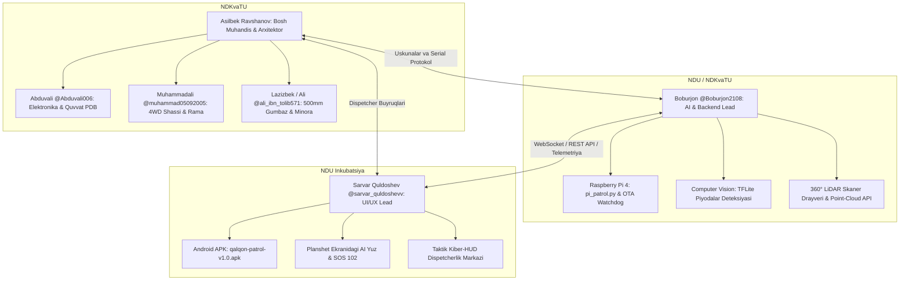

# 👥 "QALQON v1.0" — Jamoa A'zolari Vazifalar Taqsimoti va Texnik Ijro Rejasi

Ushbu hujjat **Navoiy viloyati IIB** texnik topshirig'i hamda **NDKvaTU + NDU** hamkorligi doirasida ishlab chiqilayotgan «QALQON v1.0» avtonom patrul roboti bo'yicha jamoaning 6 nafar muhandisi o'rtasidagi vazifalar taqsimoti, mas'uliyat sohalari va texnik integratsiya interfeyslarini belgilaydi.

---

## 🏛️ Jamoa Strukturasi va Mas'uliyat Matritsasi

---

## 1. ABDUVALI (@Abduvali006)
* **Lavozimi:** Elektron qism va quvvat taqsimoti muhandisi (Electronics & Power Systems Engineer)
* **Telegram:** [https://t.me/Abduvali006](https://t.me/Abduvali006)
* **Javobgarlik sohasi:** Robotning elektr ta'minoti, quvvat taqsimlash platasi (PDB), DC-DC step-down konvertorlar, datchiklar ulanish sxemalari va kabel trassasi.

### 🎯 Abduvalining Asosiy Vazifalari:
1. **Quvvat Tizimi (Power Distribution Board - PDB):**
   * 12V LiFePO4 akkumulyatoridan (kamida 6 soat uzluksiz avtonom ishlash uchun ~25-30Ah) barqaror quvvat taqsimotini loyihalash:
     * 12V to'g'ridan-to'g'ri: 4 ta 12V JGB37-520 metall reduktorli motor drayveri va 12V teleskopik minora chiziqli aktuatori uchun;
     * DC-DC Step-Down (5V 3A): Raspberry Pi 4 B bort kompyuteri uchun;
     * DC-DC Step-Down (5V 3A): Old 8.7" interaktiv planshet uchun;
     * DC-DC Step-Down (5V 2A): Arduino Mega/Uno, LD19 LiDAR va ultratovush sensorlari uchun.
2. **Elektron Prinsipial Sxema va Ulanish Xaritasi:**
   * 4 dona HC-SR04 ultratovush to'siq datchiklari, LD19 LiDAR, Pi Camera V2, 360° politsiya stroboskoplari (qizil/ko'k LED drayveri) va favqulodda sirenani Arduino/Raspberry Pi bilan ulanish pinout xaritasini (`EasyEDA` / `KiCAD`) tayyorlash.
3. **Simlar Marshruti (Wire Harness):**
   * Teleskopik minora $150-180\text{ mm}$ ko'tarilib-tushganda datchik simlari qisilib yoki uzilib ketmasligi uchun egiluvchan spiral sim zanjirini (drag chain) joylashtirish.
4. **Xavfsizlik va Himoya:**
   * Favqulodda to'xtatish (E-Stop) apparat tugmasi va batareya kuchlanish/tok monitoringi (INA219) modulini o'rnatish.

---

## 2. MUHAMMADALI (@muhammad05092005)
* **Lavozimi:** Shassi va mexanik yurish qismi konstruktori (Chassis & Drive Base Engineer)
* **Telegram:** [https://t.me/muhammad05092005](https://t.me/muhammad05092005)
* **Javobgarlik sohasi:** 4WD differensial shassi, motor kronshteynlari, asosiy rama va podveska.

### 🎯 Muhammadalining Asosiy Vazifalari:
1. **4WD Differensial Shassi Montaji:**
   * 4 dona $\varnothing 120 - 130\text{ mm}$ all-terrain kauchuk rezina shinalarni 12V metall reduktorli motorlar (JGB37-520) bilan 12 mm guruch geksagonal adapterlar orqali biriktirish.
2. **Motor Kronshteynlari:**
   * 4 ta motor uchun 3 mm sovuq prokat po'lat L-kronshteynlarni loyihalash va asosiy ramkaga mustahkam fiksatsiya qilish.
3. **Asosiy Asos Plitasi (Baseplate):**
   * 4 mm qalinlikdagi D16T duralyuminiy plitaning lazer kesish chizmasini (`DXF`) chiqarish ($450 \times 400\text{ mm}$).
   * Batareya xonasini pastki markazga joylashtirib, og'irlik markazini (CoG) tushirish va klirensni $45-50\text{ mm}$ ga sozlash.
4. **Statik va Dinamik Sinov:**
   * Shassining umumiy 25-30 kg yuk ostida bruschatka va notekis yo'laklarda egilmasligini va tebranishga chidamliligini ta'minlash.

---

## 3. LAZIZBEK / ALI (@ali_ibn_tolib571)
* **Lavozimi:** Korpus, tashqi gumbaz va teleskopik mexanizmlar konstruktori (Enclosure & Mechanisms CAD Engineer)
* **Telegram:** [https://t.me/ali_ibn_tolib571](https://t.me/ali_ibn_tolib571)
* **Javobgarlik sohasi:** $\varnothing 500\text{ mm}$ monolit gumbaz, old planshet kassetasi va Z-o'qi teleskopik minora lifti.

### 🎯 Lazizbek (Ali)ning Asosiy Vazifalari:
1. **$\varnothing 500\text{ mm}$ Monolit Yarim Shar Korpus:**
   * Tashqi silliq, aerodinamik va suv o'tkazmaydigan (IP66) kompozit / ABS gumbaz 3D CAD modelini (`STEP` / `STL`) ishlab chiqish.
   * Yuqori markazda $\varnothing 150\text{ mm}$ teleskopik lyuk darchasi va pastda shinalar uchun arkalarni loyihalash.
2. **Old Planshet Ramkasi ($65^\circ$ Bezel):**
   * 8.7" planshet ekrani uchun $60^\circ - 65^\circ$ ergonomik burchakli ramka, 4 mm zarbaga chidamli bronlangan polikarbonat oyna va silikon germetik qistirma (gasket) joyini loyihalash.
3. **Teleskopik Yashirin Minora (Z-Axis Retractable Mast):**
   * 12V mini chiziqli aktuator ($150-180\text{ mm}$ stroke) va 2 ta $\varnothing 8\text{ mm}$ yo'naltiruvchi vallar yordamida ko'tariluvchi lift karkasini chizish.
   * Minora ustki qopqog'iga O-ring qistirmani montaj qilish va ichki platformaga 360° LD19 LiDAR, panoramik kamera va stroboskop o'rnatish moslamasini birlashtirish.

---

## 4. BOBURJON BOZOROV (@Boburjon2108)
* **Lavozimi:** Backend, Sun'iy Intellekt va O'rnatilgan Tizimlar Rahbari (AI, Vision & Embedded Systems Lead)
* **Telegram:** [https://t.me/Boburjon2108](https://t.me/Boburjon2108)
* **Javobgarlik sohasi:** Raspberry Pi operatsion tizimi, kompyuter ko'rishi (OpenCV, TFLite), sensorlar integratsiyasi va OTA avto-yangilanish.

### 🎯 Boburjonning Asosiy Vazifalari:
1. **Raspberry Pi Backend & Serial Daemon (`pi_patrol.py`, `qalqon_brain.py`):**
   * Arduino bilan USB Serial orqali 115200 baud tezlikda uzluksiz ma'lumot almashinuvini ta'minlash.
   * Sarvarning frontend ilovasi uchun WebSocket yoki HTTP API serverini boshqarish.
2. **Kompyuter Ko'rishi va AI Deteksiya:**
   * Repozitoriydagi `road_signs_quantized_edgetpu.tflite` modelini ulab, old kamera orqali piyodalar (`Person`), qizil STOP belgisi va svetofor chiroqlarini real vaqtda aniqlash.
3. **360° LiDAR Ma'lumotlarini Uzatish:**
   * LD19 drayverini ishga tushirib, to'siqlar nuqtalar bulutini (Point Cloud) Sarvarning radar interfeysiga uzatish.

---

## 5. SARVAR QULDOSHEV (@sarvar_quldoshevv)
* **Lavozimi:** Frontend, Mobil Boshqaruv va Kiber-HUD Dispetcherlik Markazi Rahbari (UI/UX & Mobile Lead)
* **Email:** `qoldoshevsarvar648@gmail.com`
* **Telegram:** [https://t.me/sarvar_quldoshevv](https://t.me/sarvar_quldoshevv)
* **Javobgarlik sohasi:** Foydalanuvchi interfeysi (UI), Android boshqaruv ilovasi, robotning old planshetidagi kiber-ko'zlar va IIV dispetcherlik paneli.

### 🎯 Sarvarning Asosiy Vazifalari:
1. **Old Planshet Yuz Interfeysi (Tablet Kiosk UI):**
   * Robot oldidagi 8.7" planshet uchun doimiy ishlovchi kiber-mimika (AI sergak ko'zlari) rejimini sozlash.
   * Fuqaro yaqinlashganda ekranda **"🆘 102 TEZKOR YORDAM"** qizil tugmasini ko'rsatish va bosilganda dispetcher bilan aloqani ochish.
2. **Android Ilova (`frontend/android`):**
   * Mavjud `qalqon-patrol-v1.0.apk` ilovasini yangilangan differensial shassi buyruqlariga (`F`, `B`, `L`, `R`, `S`) va teleskopik minora boshqaruviga (`U`, `D`) moslashtirish.
3. **Telemetriya va Radar Paneli:**
   * Boburjon uzatadigan 360° LiDAR ma'lumotlarini taktik Kiber-HUD radar oynasida sweep shaklida aks ettirish.

---

## 6. ASILBEK RAVSHANOV (@Asilbek_Ravshanov04)
* **Lavozimi:** Mexatronika va Apparat Konstruksiyasi Bosh Muhandisi & Loyiha Arxitektori (Mechatronics & Hardware Lead)
* **Javobgarlik sohasi:** Umumiy apparat arxitekturasi, mexanika va elektronika integratsiyasi, avtonom zaryadlash stansiyasi va jamoa muvofiqlashtiruvi.
* **Yagona rasmiy hisoboti:** [`MEXATRONIKA_HISOBOT_VA_REJA.md`](MEXATRONIKA_HISOBOT_VA_REJA.md)

---

## 🔗 Aloqa va Hisobot Almashish Qoidalari:
1. **Shaxsiy Yozishma Standarti:** Muhandislarga topshiriqlar va hisobotlar faqat shaxsiy (DM) orqali yetkaziladi.
2. **Hisobot Talab Qilish:** Bosh muhandis (Asilbek) buyurgan paytda har bir muhandis o'z yo'nalishi bo'yicha bajarilgan ishlar holati, chizmalar va sxemalar progressini taqdim etadi.
3. **GitHub Integratsiyasi:** Barcha kodlar, sxemalar va 3D modellar `main` tarmog'iga commit qilib boriladi.
