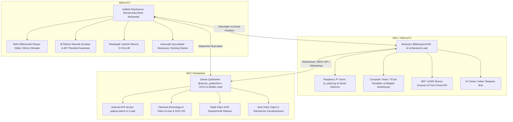

# 👥 "QALQON v1.0" — Jamoa A'zolari Vazifalar Taqsimoti va Texnik Ijro Rejasi

Ushbu hujjat **Navoiy viloyati IIB** texnik topshirig'i hamda **NDKvaTU + NDU** hamkorligi doirasida ishlab chiqilayotgan "QALQON" avtonom patrul roboti bo'yicha jamoaning 3 ta asosiy muhandisi o'rtasidagi vazifalar taqsimoti, javobgarlik sohalari va integratsiya interfeyslarini belgilaydi.

---

## 🏛️ Jamoa Strukturasi va Mas'uliyat Matritsasi

---

## 1. SARVAR QULDOSHEV (@sarvar_quldoshevv)
* **Lavozimi:** Frontend, Mobil Boshqaruv va Kiber-HUD Dispetcherlik Markazi Rahbari (UI/UX & Mobile Lead)
* **Email:** `qoldoshevsarvar648@gmail.com`
* **Telegram:** [https://t.me/sarvar_quldoshevv](https://t.me/sarvar_quldoshevv)
* **Javobgarlik sohasi:** Foydalanuvchi interfeysi (UI), Android boshqaruv ilovasi, robotning old planshetidagi kiber-ko'zlar va IIV dispetcherlik paneli.

### 🎯 Sarvarning Aniq Vazifalari (Action Items):
1. **Old Planshet Yuz Interfeysi (Tablet Kiosk UI):**
   * Robot oldidagi 8.7" planshet uchun doimiy ishlovchi kiber-mimika (AI sergak ko'zlari) rejimini sozlash.
   * Fuqaro yaqinlashganda ekranda **"🆘 102 TEZKOR YORDAM"** qizil tugmasini ko'rsatish va bosilganda to'g'ridan-to'g'ri dispetcher bilan ikki tomonlama audio/video aloqani ochish.
2. **Android Ilova (`frontend/android`):**
   * Mavjud `qalqon-patrol-v1.0.apk` ilovasini yangilangan differensial shassi buyruqlariga (`F`, `B`, `L`, `R`, `S`) va teleskopik minora boshqaruviga (`U` — ko'tarish, `D` — tushirish) moslashtirish.
3. **Telemetriya va Radar Paneli (`LidarRadarView.tsx`):**
   * Boburjon uzatadigan 360° LiDAR ma'lumotlarini ekranda aylanuvchi radar sweeps shaklida ko'rsatish.
   * 4 ta HC-SR04 datchigi masofasi 25 sm dan kam bo'lganda ekranda vizual qizil xavf ogohlantirishini chiqarish.

---

## 2. BOBURJON (@Boburjon2108)
* **Lavozimi:** Backend, Sun'iy Intellekt va O'rnatilgan Tizimlar Rahbari (AI, Vision & Embedded Systems Lead)
* **Telegram:** [https://t.me/Boburjon2108](https://t.me/Boburjon2108)
* **Javobgarlik sohasi:** Raspberry Pi operatsion tizimi, kompyuter ko'rishi (OpenCV, TFLite), sensorlar integratsiyasi va tarmoq xizmatlari.

### 🎯 Boburjonning Aniq Vazifalari (Action Items):
1. **Raspberry Pi Backend & Serial Daemon (`pi_patrol.py`):**
   * Arduino bilan USB Serial orqali 115200 baud tezlikda uzluksiz ma'lumot almashinuvini ta'minlash.
   * Sarvarning frontend ilovasi uchun WebSocket yoki HTTP API serverini boshqarish.
2. **Kompyuter Ko'rishi va AI Deteksiya:**
   * Repozitoriydagi `road_signs_quantized_edgetpu.tflite` modelini ulab, old kamera orqali piyodalar (`Person`), qizil STOP belgisi va svetofor chiroqlarini real vaqtda aniqlash.
   * Odam yoki to'siq ko'ringanda avtomatik tormozlanish buyrug'ini Arduinoga uzatish.
3. **360° LiDAR Ma'lumotlarini Uzatish:**
   * LD19 / RPLiDAR drayverini ishga tushirib, to'siqlar nuqtalar bulutini (Point Cloud) Sarvarning radar interfeysiga uzatish.
4. **IIV Tezkor Xabarnoma Telegram Boti:**
   * Fuqaro planshetdagi "102 SOS" tugmasini bosganda yoki robot xavfli hodisani aniqlaganda, voqea joyining fotosurati va robot koordinatasini IIV navbatchilik guruhiga Telegram bot orqali avtomatik jo'natish.

---

## 3. ASILBEK RAVSHANOV (@Asilbek_Ravshanov)
* **Lavozimi:** Mexatronika va Apparat Konstruksiyasi Bosh Muhandisi (Mechatronics & Hardware Lead)
* **Javobgarlik sohasi:** Korpus, shassi, motorlar, teleskopik mexanizm, quvvat ta'minoti va avtomatik zaryadlash stansiyasi.
* **Yagona rasmiy hisoboti:** [`MEXATRONIKA_HISOBOT_VA_REJA.md`](MEXATRONIKA_HISOBOT_VA_REJA.md)

### 🎯 Asilbekning Bajarayotgan Vazifalari:
1. $\varnothing 500\text{ mm}$ monolit ABS yarim shar korpusi va 65° qiyalikdagi planshet kassetasi montaji.
2. 4WD differensial shassi: 4 ta oddiy all-terrain kauchuk shina ($\varnothing 130\text{ mm}$), 12V DC reduktorli motorlar va 4mm alyuminiy asos.
3. Teleskopik yashirin minora lift aktuatori (LiDAR, 360° kamera va stroboskopni 180mm yuqoriga chiqarish).
4. Avtomatik quvvatlash stansiyasi (Docking Station) kontakt mexanizmi.

---

## 🔗 Texnik Integratsiya Bog'lamalari (API & Protokol)

1. **Mexatronika (Asilbek) -> Backend (Boburjon):**
   * Serial Port: `/dev/ttyACM0` (115200 baud).
   * Harakat buyruqlari: `'F'`, `'B'`, `'L'`, `'R'`, `'S'`.
   * Minora buyruqlari: `'U'` (ko'tarish), `'D'` (yashirish).
   * Qaytuvchi datchik signallari: `WARN:OBSTACLE_FRONT`, `DIST:XXcm`.
2. **Backend (Boburjon) -> Frontend (Sarvar):**
   * Video oqimi: `http://<ROBOT_IP>:8000/video_feed`
   * Boshqaruv API: `http://<ROBOT_IP>:8000/cmd?c=<COMMAND>`
   * Radar ma'lumotlari: JSON / WebSocket oqimi.
