# ⚙️ QALQON v1.0 — Mexatronika va Konstruksiya Bo'yicha Yagona Hisobot va Ish Rejasi

> **Mas'ul xodim (Rol):** Mexatronika va apparat konstruksiyasi bo'yicha bosh muhandis (Mechatronics & Hardware Lead)  
> **Loyiha repozitoriysi:** [https://github.com/Asil2004/My-autnomius-car](https://github.com/Asil2004/My-autnomius-car)  
> **Oxirgi yangilanish sanasi:** 2026-10-31  
> **Holat:** Faol ishlab chiqish bosqichida (Active In-Progress)

---

## 📌 Asosiy Kanonik Dizayn Konsepsiyasi

Jamoamiz tomonidan tasdiqlangan bosh model: **QALQON v1.0 Police Patrol Robot Prototype**

### 📐 Asosiy Konstruktiv Talablar va Gabaritlar:
* **Korpus shakli:** **$\varnothing = 500\text{ mm}$ Yarim shar (Hemisphere dome)** aerodinamik, zarbaga chidamli va jiddiy politsiya patrul shakli.
* **Old Interaktiv Planshet (AI & Muloqot):** Gumbazning old markaziy qismida **8.0 – 8.7 dyuymli sensorli planshet**. U sun'iy intellekt kiber-ko'zlari (mimika), fuqarolar bilan ovozli/matnli muloqot va **"SOS 102"** tezkor chaqiruv paneli vazifasini bajaradi. Tik turgan piyodaga qulay bo'lishi uchun **$60^\circ - 65^\circ$ qiyalik burchagi** ostida joylashtiriladi.
* **Tashqi o'lchamlar:** Eni: $450\text{ mm}$ | Bo'yi: $550\text{ mm}$ | Balandligi: $450\text{ mm}$ (yuqori kamera minorasi bilan).
* **Umumiy loyihaviy og'irlik:** $20 - 28\text{ kg}$ (pastga tushirilgan og'irlik markazi bilan).
* **Harakatlanish usuli:** **4WD Mecanum** mustaqil g'ildirakli platforma (joyida 360° burilish va burilmasdan yonboshga strafe harakati).
* **Himoya darajasi:** Chang va chayqaladigan yomg'ir suvidan himoyalangan **IP54** germetiklik standarti.

---

## 🏗️ Mexatronika Qismining Qavatma-Qavat (Exploded View) Arxitekturasi

```mermaid
graph TD
    subgraph 1-Qavat [Eng Yuqori: Sensor va Signal Minorasi]
        CAM360[360° Panoramik Kamera / Fisheye 5MP]
        STROBE[Politsiya Miqalkasi + 12V LED Sirena]
        PROJ[2 dona Boshqariladigan LED Proyektor: Servomotorli]
    end

    subgraph 2-Qavat [Old Interfeys & Tashqi Gumbaz: 500 mm Yarim Shar]
        DOME[Ø 500 mm ABS / Kompozit Yarim Shar Gumbaz]
        TABLET[8.7 Dyuymli Planshet: AI Yuz / Muloqot / SOS 102]
        VISOR[65° Ergonomik Qiya Ramka + 4mm Bronlangan Polikarbonat]
        FRONTCAM[Old Kamera Moduli: Yuqoriga 15° qiya o'rnatilgan]
        SPEAKER[5W Suvga Chidamli Dinamik + I2S Mikrofon]
    end

    subgraph 3-Qavat [Elektronika Steki: Vertikal Mezonin]
        RPI[Raspberry Pi 3/4/5: Yuqori Aql / AI / Veb-Server]
        ARDUINO[Arduino Uno: Quyi Refleks / PWM Boshqaruv]
        DRIVER[Motor Drayveri: L293D / BTS7960]
        STEPDOWN[DC-DC Step-Down UBEC Quvvat Transformatorlari: 12V -> 5V 3A]
    end

    subgraph 4-Qavat [Quvvat va Shassi: Pastki Asos]
        BASE[4 mm Alyuminiy Dural D16T Qattiq Asos Plitasi]
        BATTERY[12V LiFePO4 / Li-ion Akkumulyator Batareyasi: 15-20Ah]
        MOTORS[4 ta 12V Reduktorli DC Motor: Po'lat L-kronshteynlarda]
        WHEELS[4 ta 100-130 mm Mecanum Rolikli G'ildiraklar]
        SONARS[4 tomonlama HC-SR04 Ultratovush To'siq Datchiklari]
    end

    CAM360 --> DOME
    STROBE --> DOME
    PROJ --> DOME
    DOME --> BASE
    TABLET --> VISOR
    VISOR --> DOME
    FRONTCAM --> DOME
    SPEAKER --> DOME
    RPI --> BASE
    ARDUINO --> BASE
    DRIVER --> BASE
    BATTERY --> BASE
    MOTORS --> BASE
    MOTORS --> WHEELS
    SONARS --> BASE
```

---

## 📋 Amalga Oshirilgan Ishlar Hisoboti (Changelog)

### [2026-10-31 — Yangilanish 2]: Old Planshet (AI & Muloqot Moduli) Loyihalashtirildi
* ✅ **Muloqot ekrani talabi kiritildi:** $\varnothing 500\text{ mm}$ gumbazning old yuzasiga 8.0–8.7 dyuymli planshet joylashtirish mexanizmi belgilandi.
* ✅ **Ergonomik burchak hisoblandi:** Tik turgan piyoda va bolalar ekranni bemalol ko'rishi va barmog'i yetishi uchun ekran gorizontga nisbatan **$65^\circ$ qiyalikda** o'rnatilishi aniqlandi.
* ✅ **Vandalga qarshi 4-qatlamli montaj standarti qo'shildi:** 
  1. Tashqi 4 mm qalinlikdagi zarbaga chidamli shaffof polikarbonat (Lexan) himoya oynasi;
  2. EPDM rezina qistirma (IP54 yomg'ir va changga qarshi);
  3. Silikon tebranishni yutuvchi burchak fiksatorlari;
  4. Ichki tomondan M4 xavfsizlik boltlar bilan qotiriladigan orqa qopqoq (tashqaridan yechib bo'lmaydi).
* ✅ **Elektr quvvati integratsiyasi:** Planshet uchun 90° burchakli Type-C kabel va doimiy 5V 3A UBEC quvvat ta'minoti kiritildi.

### [2026-10-31 — Yangilanish 1]: Bosh Shassi va Repozitoriy Ekotizimi
* ✅ **Mecanum test platformasi yig'ildi:** 4 ta motorli L293D drayverli dastlabki maket tayyorlandi va harakat kinematikasi tekshirildi.
* ✅ **Arduino dasturi yozildi:** [`arduino_l293d_patrol.ino`](arduino/arduino_l293d_patrol/arduino_l293d_patrol.ino) orqali to'liq Mecanum harakatlari sozlandi.
* ✅ **Raspberry Pi veb-kontrolleri yaratildi:** Port 8000 da jonli kamera videosi va tugmalar integratsiyasi ishga tushirildi.
* ✅ **Old ultratovush tormozi ulandi:** 22 sm masofada avtomatik to'xtash sinovdan o'tdi.
* ✅ **Qalqon v1.0 $\varnothing 500\text{ mm}$ gumbaz standarti qabul qilindi.**

---

## 🎯 Mexatronik Muhandisning Kelgusi Vazifalar Rejasi (To-Do List)

### 1. Old Planshet (AI & Muloqot) Konstruksiyasi
- [ ] **1.1.** 500 mm yarim sharning old qismida planshet o'rnatiladigan qiya ramkani (tablet visor bezel) CAD modelda chizish.
- [ ] **1.2.** 4 mm polikarbonat himoya oynasi va planshet ekranining o'lchamlarini moslashtirish (8.7" planshet uchun darcha: $215 \times 130\text{ mm}$).
- [ ] **1.3.** Planshet ustiga mikrofon teshigini, pastki qismiga esa 5W dinamik panjarasini joylashtirish.
- [ ] **1.4.** Planshet qizib ketmasligi uchun orqa qutisiga passiv shamollatish (konveksiya) teshiklarini kiritish.

### 2. Korpus va Gumbaz Ishlab Chiqarish (Ø 500 mm Yarim Shar)
- [ ] **2.1.** 500 mm tashqi diametrli yarim shar CAD 3D modelini (`STEP` / `STL`) tayyorlash.
- [ ] **2.2.** Gumbazni 3D printerda 4 ta segmentda chop etish yoki vakuumli qoliplash (3 mm ABS list).
- [ ] **2.3.** Old kamera linzasi va ultratovush datchiklar uchun o'rindiq darchalarini ochish.
- [ ] **2.4.** Yuqori minora gardishi (flanets $\varnothing 120\text{ mm}$) montaj nuqtasini mustahkamlash.

### 3. Pastki Asos Plitasi va Motorlar Montaji
- [ ] **3.1.** 4 mm D16T alyuminiy asos plitasining lazer kesish chizmasini (`DXF`) chiqarish.
- [ ] **3.2.** 4 ta DC reduktorli motorni tebranishga qarshi rezina vtulkalar orqali 3 mm po'lat L-kronshteynga bolt bilan qotirish.
- [ ] **3.3.** Mecanum g'ildirak roliklari yo'nalishini yuqoridan qaralganda qat'iy **`X`** shaklida montaj qilish.
- [ ] **3.4.** Pastki klirensni ($35–45\text{ mm}$) yo'l to'siqlariga nisbatan sinash.

### 4. Ichki Elektronika Tokchalari va Quvvat
- [ ] **4.1.** 12V LiFePO4 batareyani pastki markazda mahkam ushlovchi po'lat qisqich (bracket) yasash.
- [ ] **4.2.** 2 qavatli ichki mezonin (platalar tokchasi) o'rnatish:
  - 1-polka: Motor drayveri, UBEC DC-DC konverterlar, saqlagichlar;
  - 2-polka: Arduino Uno va Raspberry Pi (silikon amortizatorlarda).
- [ ] **4.3.** Kabel kanallarini tartibga solish va M12 germetik kabel o'tkazgichlarini kiritish.

### 5. Yuqori Minoracha va Aktuatorlar
- [ ] **5.1.** 360° panoramik kamera va favqulodda stroboskop (qizil/ko'k LED) minora korpusini tayyorlash.
- [ ] **5.2.** 2 dona old LED proyektor uchun 2 o'qli servomotorli burilish mexanizmini yig'ish.
- [ ] **5.3.** Orqa korpusga suv o'tkazmaydigan Favqulodda to'xtatish (E-Stop) tugmasini joylashtirish.

---

## 🤝 Jamoa A'zolari Bilan Integratsiya Nuqtalari

1. **Dasturiy ta'minot (Software / AI Lead) guruhiga:**
   * Old planshet ekrani uchun biz avval yozgan [`tablet_face_server.py`](raspberry_pi/tablet_face_server.py) (kiber-ko'zlar, ovozli muloqot va SOS 102 chaqiruvi) kiosk rejimida to'liq ekranga chiqishi ta'minlanadi.
   * Kamera balandligi va $15^\circ$ burchak ma'lumotlari kompyuter ko'rishi algoritmlariga berildi.
2. **Elektronika va Sxemotexnika (Electronics Lead) guruhiga:**
   * Planshetga doimiy uzluksiz 5V 3A alohida UBEC quvvat liniyasi ajratiladi.
   * Dinamik va mikrofon uchun I2S / AUX ulanish kabellari uzunligi $30\text{ cm}$ qilib hisoblandi.

---

*Eslatma: Ushbu hujjat har bir mexatronik yangilanishdan so'ng yangilanadi va GitHub-ga commit qilinadi.*
