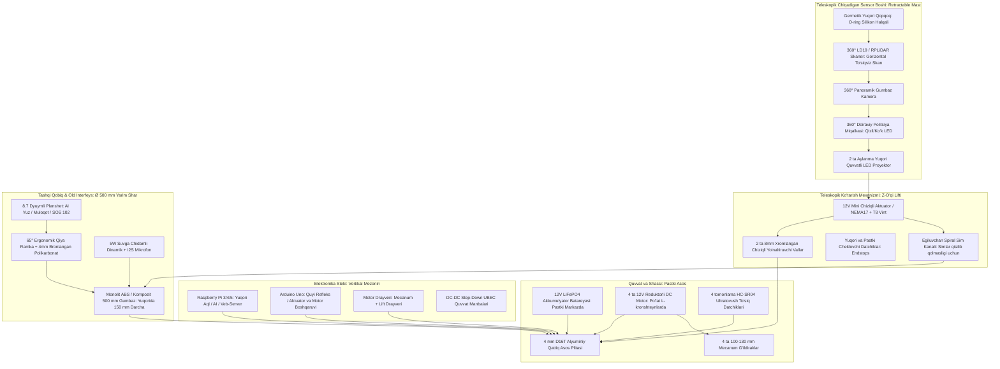

# ⚙️ QALQON v1.0 — Mexatronika va Konstruksiya Bo'yicha Yagona Hisobot va Ish Rejasi

> **Mas'ul xodim (Rol):** Mexatronika va apparat konstruksiyasi bo'yicha bosh muhandis (Mechatronics & Hardware Lead)  
> **Loyiha repozitoriysi:** [https://github.com/Asil2004/My-autnomius-car](https://github.com/Asil2004/My-autnomius-car)  
> **Oxirgi yangilanish sanasi:** 2026-10-31  
> **Holat:** Faol ishlab chiqish bosqichida (Active In-Progress)

---

## 📌 Asosiy Kanonik Dizayn Konsepsiyasi (Yashirin Teleskopik Minora)

Jamoamiz tomonidan tasdiqlangan bosh model: **QALQON v1.0 Police Patrol Robot Prototype**

### 📐 Asosiy Konstruktiv Talablar va Gabaritlar:
* **Korpus shakli:** **$\varnothing = 500\text{ mm}$ Monolit Yarim shar (Smooth Hemisphere Dome)**. Tinch (patrul) holatida gumbaz yuzasida hech qanday ortiqcha chiqib turuvchi kamera, shox yoki mo'rt datchiklar bo'lmaydi — 100% silliq, zarbaga va yomg'irga chidamli aerodinamik qobiq.
* **Teleskopik Yashirin Minora (Retractable Mast):** Faol kuzatuv yoki xavfli vaziyat yuzaga kelganda, gumbazning eng yuqori qopqog'i motorli **teleskopik lift mexanizmi orqali $150 - 200\text{ mm}$ yuqoriga ko'tariladi**. Ko'tarilgach, uning ichidan:
  * 360° LiDAR lazer skaneri (to'siqsiz gorizontal ko'rish maydoni bilan);
  * 360° Panoramik / PTZ gumbaz kamera;
  * 360° Politsiya stroboskopi (qizil/ko'k miltillovchi chiroqlar);
  * 2 dona quvvatli aylanma LED proyektorlar ochilib ishlaydi.
* **Old Interaktiv Planshet (AI & Muloqot):** Gumbazning old markaziy qismida **8.0 – 8.7 dyuymli sensorli planshet**. U sun'iy intellekt kiber-ko'zlari (mimika), fuqarolar bilan ovozli/matnli muloqot va **"SOS 102"** tezkor chaqiruv paneli vazifasini bajaradi. **$60^\circ - 65^\circ$ ergonomik qiyalikda**, 4 mm bronlangan polikarbonat oyna ortida joylashgan.
* **Tashqi o'lchamlar:** Eni: $450\text{ mm}$ | Bo'yi: $550\text{ mm}$ | Balandligi: Yopiq holatda $380\text{ mm}$, minora ochilganda $550\text{ mm}$.
* **Harakatlanish usuli:** **4WD Mecanum** mustaqil g'ildirakli platforma (joyida 360° burilish va burilmasdan yonboshga strafe harakati).
* **Himoya darajasi:** Minora yopiq holatda **IP66**, ochilgan holatda **IP54** germetiklik standarti.

---

## 🏗️ Mexatronika Qismining Qavatma-Qavat (Exploded View) Arxitekturasi

---

## 📋 Amalga Oshirilgan Ishlar Hisoboti (Changelog)

### [2026-10-31 — Yangilanish 3]: Teleskopik Yashirin Minora Konsepsiyasi Qo'shildi
* ✅ **Monolit qobiq konsepsiyasi:** Gumbaz ustidagi barcha ochiq sensorlar yashirildi. Vandalizm, daraxt shoxlari va kuchli yomg'irdan himoya qilish uchun datchiklar faqat zarur bo'lganda ochiladigan qilib belgilandi.
* ✅ **Teleskopik lift kinematikasi ishlab chiqildi:** $150 - 200\text{ mm}$ balandlikka ko'tariluvchi 12V mini elektr aktuator (yoki T8 vintli NEMA17) va 2 ta yo'naltiruvchi chiziqli val arxitekturasi kiritildi.
* ✅ **Germetiklik (O-ring) yechimi:** Minora pastga tushganda uning qopqog'i gumbazdagi maxsus truba o'rindig'iga silikon O-ring qistirma orqali zich yopiladi (yopiq holatda IP66 to'liq germetik).
* ✅ **Spiral kabel zanjiri:** Minora ko'tarilib-tushganda LiDAR va kamera simlari buralib yoki qisilib uzilmasligi uchun spiral kabel (curly cord) kanali rejalashtirildi.

### [2026-10-31 — Yangilanish 2]: Old Planshet (AI & Muloqot Moduli) Loyihalashtirildi
* ✅ **Muloqot ekrani:** $\varnothing 500\text{ mm}$ gumbaz oldiga $65^\circ$ qiyalikda 8.7" planshet joylashtirish belgilandi.
* ✅ **Vandalga qarshi 4 qatlam:** 4 mm polikarbonat, EPDM germetik qistirma, ichki xavfsizlik boltlar.
* ✅ **Quvvat:** Doimiy 5V 3A UBEC quvvat liniyasi kiritildi.

### [2026-10-31 — Yangilanish 1]: Bosh Shassi va Repozitoriy Ekotizimi
* ✅ **Mecanum shassi:** 4 ta motorli L293D maketida harakatlar sinovdan o'tdi.
* ✅ **Arduino & RPi dasturlari:** [`arduino_l293d_patrol.ino`](arduino/arduino_l293d_patrol/arduino_l293d_patrol.ino) va [`pi_patrol.py`](raspberry_pi/pi_patrol.py) yozildi va sinovdan o'tkazildi.

---

## 🎯 Mexatronik Muhandisning Kelgusi Vazifalar Rejasi (To-Do List)

### 1. Teleskopik Ko'tarish Mexanizmi (Z-Axis Retractable Mast)
- [ ] **1.1.** $150\text{ mm}$ yurish yo'liga (stroke) ega 12V chiziqli aktuator (Linear Actuator) yoki NEMA17 qadamli motor + T8 Trapezoid vint mexanizmining 3D CAD yig'masini tayyorlash.
- [ ] **1.2.** Tebranishsiz silliq harakatlanish uchun 2 ta $\varnothing 8\text{ mm}$ silliqlangan vallar (Linear Shafts) va chiziqli podshipniklar (LM8UU) korpusini loyihalash.
- [ ] **1.3.** Yuqori va pastki so'nggi nuqtalarni aniqlovchi 2 dona germetik chegaraviy datchik (Endstop Limit Switches) o'rnatish.
- [ ] **1.4.** Minora qopqog'iga O-ring silikon qistirmani joylashtirish va gumbazning $\varnothing 150\text{ mm}$ yuqori darchasiga suv kirmaydigan qulf fiksatorini loyihalash.
- [ ] **1.5.** Ko'tariluvchi sensorlar (LiDAR, kamera, LED) uchun spiral egiluvchan sim yo'lagini (Drag Chain) hisoblash.

### 2. Old Planshet (AI & Muloqot) Konstruksiyasi
- [ ] **2.1.** 500 mm yarim sharning old qismida planshet o'rnatiladigan $65^\circ$ qiya ramkani (visor bezel) CAD modelda chizish.
- [ ] **2.2.** 4 mm polikarbonat himoya oynasi va planshet ekranining o'lchamlarini moslashtirish ($215 \times 130\text{ mm}$).
- [ ] **2.3.** Planshet ustiga mikrofon teshigini, pastki qismiga esa 5W dinamik panjarasini joylashtirish.
- [ ] **2.4.** Planshet qizib ketmasligi uchun orqa qutisiga passiv konveksiya ventilyatsiyasini kiritish.

### 3. Korpus va Gumbaz Ishlab Chiqarish (Ø 500 mm Monolit Yarim Shar)
- [ ] **3.1.** 500 mm tashqi diametrli monolit yarim shar CAD 3D modelini (`STEP` / `STL`) tayyorlash.
- [ ] **3.2.** Gumbazni 3D printerda 4 ta segmentda chop etish yoki 3 mm ABS listdan vakuumli qolipda tortish.
- [ ] **3.3.** Gumbaz tepasida teleskopik minora chiqishi uchun $\varnothing 150\text{ mm}$ aylanma lyuk kesimini hosil qilish.

### 4. Pastki Asos Plitasi va Motorlar Montaji
- [ ] **4.1.** 4 mm D16T alyuminiy asos plitasining lazer kesish chizmasini (`DXF`) chiqarish.
- [ ] **4.2.** 4 ta DC reduktorli motorni tebranishga qarshi rezina vtulkalar orqali 3 mm po'lat L-kronshteynga bolt bilan qotirish.
- [ ] **4.3.** Mecanum g'ildirak roliklari yo'nalishini yuqoridan qaralganda qat'iy **`X`** shaklida montaj qilish.
- [ ] **4.4.** Pastki klirensni ($35–45\text{ mm}$) piyodalar yo'lagi to'siqlariga nisbatan sinash.

### 5. Ichki Elektronika Tokchalari va Quvvat
- [ ] **5.1.** 12V LiFePO4 batareyani pastki markazda mahkam ushlovchi po'lat qisqich (bracket) yasash.
- [ ] **5.2.** 2 qavatli ichki mezonin (platalar tokchasi) o'rnatish:
  - 1-polka: Motor drayveri, Lift aktuator drayveri, UBEC DC-DC konverterlar, saqlagichlar;
  - 2-polka: Arduino Uno va Raspberry Pi (silikon amortizatorlarda).
- [ ] **5.3.** M12 germetik kabel o'tkazgichlarini kiritish.

---

## 🤝 Jamoa A'zolari Bilan Integratsiya Nuqtalari

1. **Dasturiy ta'minot (Software / AI Lead) guruhiga:**
   * Teleskopik minora boshqaruvi: Arduino-ga `MAST_UP` va `MAST_DOWN` buyruqlari qo'shiladi. Patrul boshlanganda minora avtomatik ko'tariladi, robot to'xtab quvvatlanganda yoki yomg'ir aniqlanganda yashirinadi.
   * Old planshet ekrani uchun [`tablet_face_server.py`](raspberry_pi/tablet_face_server.py) (kiber-ko'zlar va 102 SOS chaqiruvi) kiosk rejimida to'liq ekranga ulanadi.
2. **Elektronika va Sxemotexnika (Electronics Lead) guruhiga:**
   * Teleskopik lift aktuatori uchun 12V 2A quvvat va H-ko'prikli rele/drayver kanali ajratiladi.
   * Minora chekkalaridagi 2 ta Endstop mikroviklyuchatellari Arduino-ning raqamli pinlariga ulanadi.

---

*Eslatma: Ushbu hujjat har bir mexatronik yangilanishdan so'ng yangilanadi va GitHub-ga commit qilinadi.*
