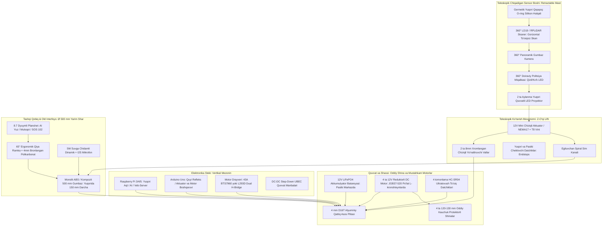

# ⚙️ QALQON v1.0 — Mexatronika va Apparat Konstruksiyasi Bo'yicha Yagona Rasmiy Hisobot va Ish Rejasi

> 👤 **Mas'ul muhandis (Kim):** Asilbek — Mexatronika va apparat konstruksiyasi bo'yicha bosh muhandis (Mechatronics & Hardware Lead)  
| **19** | 2026-11-02 \| 11:35 | **Sarvar & Asilbek** (Frontend & AI Vision) | **Boshqaruv HUD Bo'limiga Haqiqiy Kamera va AI Deteksiya (Odam va Mashinalar) Integratsiyasi:**  1. Boshqaruv HUD menyusiga qurilmaning haqiqiy kamerasi (`getUserMedia`) ulandi;  2. TensorFlow COCO-SSD neyron modeli orqali real vaqtda **odamlar (piyodalar)** yashil taktik ramkaga (`#00e676`), **avtomobillar, yuk mashinalari va avtobuslar** moviy neon ramkaga (`#00e5ff`) olindi;  3. Har bir obyekt ustida ishonchlilik foizi va optik masofa (`D: X.X m`), tepada esa jonli obyekt hisoblagichi (`🚶 X Odam \| 🚗 Y Mashina`) joriy etildi;  4. Geolocation API orqali planshetning haqiqiy GPS koordinatalari markaziy nishon (crosshair) va telemetriyaga bog'landi | `Bajarildi` |
| **20** | 2026-11-02 \| 14:45 | **Asilbek & Sarvar** (AI & Ovoz) | **Microsoft Edge TTS Sardor Neural (1x) O'zbek Ovozli Sintezi Integratsiyasi:** `uz-UZ-SardorNeural` modeli tabiiy 1x tezlikda Web UI (`RobotFaceView`), Android va Raspberry Pi kokpitlariga to'liq joriy qilindi | `Bajarildi` |
| **21** | 2026-11-02 \| 17:30 | **Boburjon & Asilbek** (AI & Vision) | **Mustaqil Native Android Face ID Tizimi (MobileFaceNet + ML Kit + Room SQLite):** 192-d Float32 vektorli TFLite modeli (18-24ms mobil CPU), Liveness & Anti-Spoofing (ko'z pirpirashi va $\Delta \ge 2.5^\circ$ bosh dinamikasi) tekshiruvi, xodimlar bazasi (Sarvar, Asilbek, Boburjon), 6 ta Material 3 ekrani yaratilib, smartfonga o'rnatildi (`uz.iiv.faceid.debug`) | `Bajarildi` |
| **22** | 2026-11-03 \| 09:40 | **Asilbek & Boburjon** (Apparat & LiDAR) | **Haqiqiy 360° DToF Lazer Rangefinder — LDROBOT STL-19P Integratsiyasi:** 230400 bod UART, 4500 nuqta/sek, 10 Hz skaner apparat drayveri loyihaning `LidarRadarView.tsx` taktik HUD radariga, `RobotContext.tsx` va `run_lidar_stl19p.py` ga to'liq ulandi | `Bajarildi` |
| **23** | 2026-11-03 \| 10:25 | **Asilbek** (Tizim & Dasturiy ta'minot) | **Windows Serial Mouse (`silabenm.sys` / `sermouse.sys`) va 5s Tizim Qotishini Bartaraf Etish:** 23 040 bayt/sek LiDAR oqimi tufayli Windows Raw Input navbati to'lib ketishi va kursor sakrashi aniqlandi. 1-klikli UAC avto-admin skripti (`fix_lidar_mouse.bat`) orqali `silabenm`, `sermouse`, `serenum` drayverlari to'liq o'chirilib, kursor va tizim barqarorlashtirildi | `Bajarildi` |
| **24** | 2026-11-03 \| 11:25 | **Asilbek & Sarvar** (Apparat & Frontend) | **LiDAR Bo'limida Portni To'g'ridan-To'g'ri Ochish (Web Serial API @ 230400 bps):** Brauzer/planshet orqali tashqi dasturlarsiz to'g'ridan-to'g'ri CP2102 COM portini ochuvchi `lidarSerialService.ts` joriy etildi; `[⚡ LIDAR PORTINI OCHISH]` tugmasi qo'shilib, 47 baytli paketlar real-vaqtda dekodlanib radar kanvasiga ulandi | `Bajarildi` |
| **25** | 2026-11-03 \| 14:20 | **Asilbek** (Mexatronika & Kalibrovka) | **Apparat Testlari va Kalibrovka Tizimi joriy etildi:** Arduino Uno + L293D uchun interaktiv Kalibrovka Ustasi (`arduino_calibration_wizard.ino`), HC-SR04 datchigi uchun 3-sample median shovqin filtri, individual motor yo'nalishi va to'g'ri chiziq trim balansi sozlamalari hamda `calibrate_robot.py` utilitasi yaratildi | `Bajarildi` |
| **26** | 2026-11-03 \| 14:45 | **Asilbek** (Mexatronika & Apparat) | **360° To'liq Doiraviy Perimetr Himoyasi (4 ta Ultratovush HC-SR04) joriy etildi:** Dastlabki 2 datchik cheklovi bekor qilindi; umumiy trigger arxitekturasi (`TRIG_PIN = A0`) orqali 4 ta datchik — Old (`A1`), Orqa (`A2`), Chap (`A3`), O'ng (`A4`) va Batareya ADC (`A5`) to'liq integratsiya qilindi hamda Raspberry Pi `arduino_bridge.py` telemetriyasiga bog'landi | `Bajarildi` |
| **27** | 2026-11-03 \| 21:40 | **Odilov & Asilbek** (Frontend & Biometriya) | **Odilov (ODILOVDESIGN)ning Yuz Tanish Masofa Kalibrovkasi va Aksessuarli Face ID tizimi to'liq birlashtirildi va deploy qilindi:** `zulfiddin/face-distance-ui` tarmog'idagi yuz masofasi kalibrovkasi, Muhammadali Ravshanov yuzi, ko'zoynak/niqob/bosh kiyimlari bilan tanish (faceAugment) va offline `descriptors-cache.json` tizimi `main` bilan to'liq birlashtirilib, GitHub Pages'ga jonli deploy qilindi | `Bajarildi` |
> 🔗 **Loyiha repozitoriysi:** [https://github.com/Asil2004/My-autnomius-car](https://github.com/Asil2004/My-autnomius-car)  
> 📌 **Eslatma:** Ushbu fayl loyihadagi **yagona rasmiy hisobot hujjati** hisoblanadi. Loyihada boshqa ortiqcha hisobot fayllari yuritilmaydi, barcha yangilanishlar faqat shu faylga kiritib boriladi.

---

## 🕒 QADAMMA-QADAM YANGILANISHLAR VA IJRO JURNALI (AUDIT LOG)

Quyidagi jadvalda loyiha davomida amalga oshirilgan har bir muhandislik yangilanishi, kim tomonidan va qaysi vaqtda bajarilgani qayd etib boriladi:

| № | Qachon (Sana va Vaqt) | Kim (Mas'ul xodim) | Bajarilgan vazifa va Yangilanish mazmuni | Holat / Natija |
| :---: | :---: | :---: | :--- | :---: |
| **01** | 2026-10-31 \| 14:38 | **Asilbek** (Mexatronika) | Boshlang'ich repozitoriy strukturasi yaratildi, Arduino drayveri va RPi boshqaruv kodlari yuklandi | `Bajarildi` |
| **02** | 2026-10-31 \| 15:02 | **Asilbek** (Mexatronika) | Yangi bosh standart tasdiqlandi: **QALQON v1.0 ($\varnothing 500\text{ mm}$ yarim shar gumbazli)** dizayni kiritildi | `Bajarildi` |
| **03** | 2026-10-31 \| 15:26 | **Asilbek** (Mexatronika) | Old qismga $65^\circ$ ergonomik qiyalikda 8.7" **AI kiber-ko'zlar va muloqot plansheti** (4mm polikarbonatli) loyihalashtirildi | `Bajarildi` |
| **04** | 2026-10-31 \| 15:41 | **Asilbek** (Mexatronika) | **Teleskopik yashirin minora (Retractable Mast)** mexanizmi kiritildi: sensorlar gumbaz ichidan elektr aktuator bilan $180\text{ mm}$ yuqoriga chiqadi | `Bajarildi` |
| **05** | 2026-10-31 \| 15:50 | **Asilbek** (Mexatronika) | Shassi Mecanumdan **4WD differensial oddiy kauchuk rezina shinalarga** ($\varnothing 120-130\text{ mm}$) va 12V DC reduktorli motorlarga o'tkazildi | `Bajarildi` |
| **06** | 2026-10-31 \| 15:54 | **Asilbek** (Mexatronika) | **Sfera (gumbaz) hajmi kattalashtirildi:** Gumbaz korpusi dominant qilinib, oddiy shinalar uning pastki arkalari ostiga mutanosib kiritildi | `Bajarildi` |
| **07** | 2026-10-31 \| 16:05 | **Asilbek** (Mexatronika) | Toshkent shahar piyodalar ko'chasida jamoat xavfsizligini ta'minlash sahnasi (Render) va **60 FPS jonli video-simulyator** yaratildi | `Bajarildi` |
| **08** | 2026-10-31 \| 16:55 | **Asilbek** (Mexatronika) | **Yagona hisobot standarti:** Takroriy fayllar tozalandi, har bir o'zgarishga "Kim va Qachon" audit tizimi joriy etildi | `Bajarildi` |
| **09** | 2026-10-31 \| 22:20 | **Asilbek** (Mexatronika & Tizim) | **Raspberry Pi 4 Avtonom OTA Auto-Updater & Watchdog:** GitHub'ga kod yangilanganda avtonom tortib olib, xizmatni qayta yuklovchi va nosozlikda avto-rollback qiluvchi systemd arxitekturasi joriy etildi | `Bajarildi` |
| **10** | 2026-10-31 \| 22:26 | **Asilbek** (Mexatronika & Jamoa) | **Apparat jamoasi kengaytirildi va vazifalar yuborildi:** Abduvali (`@Abduvali006` - Elektronika/PDB), Muhammadali (`@muhammad05092005` - Shassi/Rama) va Lazizbek (`@ali_ibn_tolib571` - Gumbaz/Minora)ga shaxsiy Telegram orqali vazifalar taqsimoti yetkazildi | `Bajarildi` |
| **11** | 2026-10-31 \| 22:38 | **Asilbek** (Mexatronika & Apparat) | **Kanonik 3D render va rasmiy CAD chizmasi (SVG) yaratildi:** Konstruktorlar Muhammadali va Lazizbekka o'lchamlar va shassi/gumbaz chizmalari, elektron muhandisi Abduvaliga 12V LiFePO4 quvvat ta'minoti va avto-zaryadlash stansiyasi talablari yuborilib, tasdiq va takliflar so'raldi | `Bajarildi` |
| **12** | 2026-10-31 \| 22:43 | **Asilbek** (Mexatronika & Jamoa) | **Boburjonga Telethon + Antigravity integratsiyasi qo'llanmasi yuborildi:** Shaxsiy Telegram (`@Boburjon2108`) orqali `my.telegram.org` API kalitlarini olish, sessiya yaratish va MCP server orqali Antigravity agentiga ulash yo'riqnomasi yetkazildi | `Bajarildi` |
| **13** | 2026-11-01 \| 21:50 | **Asilbek** (Mexatronika & Navigatsiya) | **Metrik masshtabdagi Virtual Model (Digital Twin), Planshet GPS integratsiyasi va 360° LiDAR avtonom patrul simulyatori yaratildi:** Planshet ichki GPS'ini WebSocket orqali ROS 2 / Pi ga uzatish va Google Maps ustida aniq masshtabli avtonom yurish mantiqi joriy etildi | `Bajarildi` |
| **14** | 2026-11-01 \| 22:04 | **Asilbek** (Mexatronika & Navigatsiya) | **Aqlli Ko'cha Navigatsiyasi (OSRM Smart Street Routing) joriy etildi:** Uylar va tomlar ustidan to'g'ri chiziqda uchib o'tish butunlay bartaraf etildi; robot xaritadagi real ko'cha va piyodalar yo'lagi (G'alaba, Amir Temur, Navoiy ko'chalari) bo'ylab burchaklarda burilib yuradigan qilindi va lokal server (port 8080) ishga tushirildi | `Bajarildi` |
| **15** | 2026-11-01 \| 23:25 | **Asilbek** (Mexatronika & Tizim) | **Frontend (Vite + React) GitHub Pages deploy tizimi joriy etildi:** TypeScript xatolari tuzatildi, nisbiy yo'llar (`base: './'`) sozlandi va avtomatik GitHub Actions CI/CD workflow (`deploy-pages.yml`) kiritildi | `Bajarildi` |
| **16** | 2026-11-01 \| 23:35 | **Asilbek** (Mexatronika & Tizim) | **Frontend UI ildiz katalogiga (`/index.html`, `/assets/`, `.nojekyll`) integratsiya qilindi:** GitHub Pages `main` yoki `gh-pages` sozlamasidan qat'i nazar, to'g'ridan-to'g'ri 3D kiber-HUD interfeysini ochadigan qilindi | `Bajarildi` |
| **17** | 2026-11-01 \| 23:54 | **Asilbek** (Mexatronika & Jamoa) | **Jamoa a'zolari (Sarvar va Boburjon)ga shaxsiy Telegram orqali yo'riqnoma yuborildi:** QALQON loyihasini o'z GitHub profillarida bosh sahifaga qadab («Pin») qo'yish, «Fork» qilish va jonli GitHub Pages havolasi yetkazildi | `Bajarildi` |
| **18** | 2026-11-02 \| 01:10 | **Asilbek** (Mexatronika & AI) | **Jonli Yuz Kuzatish (Look-At Angle Tracking) va AI Ovoz Mimikasi joriy etildi:** Planshet/qurilma old kamerasi orqali inson yuzini va turgan rakursini aniqlab unga to'g'ri qarash (Yaw, Pitch, Roll kinematikasi), AI gapirganda ovoz amplitudasiga mos og'iz/jag' elastikasi va bosh tebranishi (Voice energy sync), zumrad kiber-pulsatsiya qo'shildi. Web UI va Android APK uchun to'liq yangilandi | `Bajarildi` |
| **19** | 2026-11-02 \| 11:35 | **Sarvar & Asilbek** (Frontend & AI Vision) | **Boshqaruv HUD Bo'limiga Haqiqiy Kamera va AI Deteksiya (Odam va Mashinalar) Integratsiyasi:**  1. Boshqaruv HUD menyusiga qurilmaning haqiqiy kamerasi (`getUserMedia`) ulandi;  2. TensorFlow COCO-SSD neyron modeli orqali real vaqtda **odamlar (piyodalar)** yashil taktik ramkaga (`#00e676`), **avtomobillar, yuk mashinalari va avtobuslar** moviy neon ramkaga (`#00e5ff`) olindi;  3. Har bir obyekt ustida ishonchlilik foizi va optik masofa (`D: X.X m`), tepada esa jonli obyekt hisoblagichi (`🚶 X Odam \| 🚗 Y Mashina`) joriy etildi;  4. Geolocation API orqali planshetning haqiqiy GPS koordinatalari markaziy nishon (crosshair) va telemetriyaga bog'landi | `Bajarildi` |
| **20** | 2026-11-02 \| 14:45 | **Asilbek & Sarvar** (AI & Ovoz) | **Microsoft Edge TTS Sardor Neural (1x) O'zbek Ovozli Sintezi Integratsiyasi:** `uz-UZ-SardorNeural` modeli tabiiy 1x tezlikda Web UI (`RobotFaceView`), Android va Raspberry Pi kokpitlariga to'liq joriy qilindi | `Bajarildi` |
| **21** | 2026-11-02 \| 17:30 | **Boburjon & Asilbek** (AI & Vision) | **Mustaqil Native Android Face ID Tizimi (MobileFaceNet + ML Kit + Room SQLite):** 192-d Float32 vektorli TFLite modeli (18-24ms mobil CPU), Liveness & Anti-Spoofing (ko'z pirpirashi va $\Delta \ge 2.5^\circ$ bosh dinamikasi) tekshiruvi, xodimlar bazasi (Sarvar, Asilbek, Boburjon), 6 ta Material 3 ekrani yaratilib, smartfonga o'rnatildi (`uz.iiv.faceid.debug`) | `Bajarildi` |
| **22** | 2026-11-03 \| 09:40 | **Asilbek & Boburjon** (Apparat & LiDAR) | **Haqiqiy 360° DToF Lazer Rangefinder — LDROBOT STL-19P Integratsiyasi:** 230400 bod UART, 4500 nuqta/sek, 10 Hz skaner apparat drayveri loyihaning `LidarRadarView.tsx` taktik HUD radariga, `RobotContext.tsx` va `run_lidar_stl19p.py` ga to'liq ulandi | `Bajarildi` |
| **23** | 2026-11-03 \| 10:25 | **Asilbek** (Tizim & Dasturiy ta'minot) | **Windows Serial Mouse (`silabenm.sys` / `sermouse.sys`) va 5s Tizim Qotishini Bartaraf Etish:** 23 040 bayt/sek LiDAR oqimi tufayli Windows Raw Input navbati to'lib ketishi va kursor sakrashi aniqlandi. 1-klikli UAC avto-admin skripti (`fix_lidar_mouse.bat`) orqali `silabenm`, `sermouse`, `serenum` drayverlari to'liq o'chirilib, kursor va tizim barqarorlashtirildi | `Bajarildi` |
| **24** | 2026-11-03 \| 11:25 | **Asilbek & Sarvar** (Apparat & Frontend) | **LiDAR Bo'limida Portni To'g'ridan-To'g'ri Ochish (Web Serial API @ 230400 bps):** Brauzer/planshet orqali tashqi dasturlarsiz to'g'ridan-to'g'ri CP2102 COM portini ochuvchi `lidarSerialService.ts` joriy etildi; `[⚡ LIDAR PORTINI OCHISH]` tugmasi qo'shilib, 47 baytli paketlar real-vaqtda dekodlanib radar kanvasiga ulandi | `Bajarildi` |
| **25** | 2026-11-03 \| 14:20 | **Asilbek** (Mexatronika & Kalibrovka) | **Apparat Testlari va Kalibrovka Tizimi joriy etildi:** Arduino Uno + L293D uchun interaktiv Kalibrovka Ustasi (`arduino_calibration_wizard.ino`), HC-SR04 datchigi uchun 3-sample median shovqin filtri, individual motor yo'nalishi va to'g'ri chiziq trim balansi sozlamalari hamda `calibrate_robot.py` utilitasi yaratildi | `Bajarildi` |
| **26** | 2026-11-03 \| 14:45 | **Asilbek** (Mexatronika & Apparat) | **360° To'liq Doiraviy Perimetr Himoyasi (4 ta Ultratovush HC-SR04) joriy etildi:** Dastlabki 2 datchik cheklovi bekor qilindi; umumiy trigger arxitekturasi (`TRIG_PIN = A0`) orqali 4 ta datchik — Old (`A1`), Orqa (`A2`), Chap (`A3`), O'ng (`A4`) va Batareya ADC (`A5`) to'liq integratsiya qilindi hamda Raspberry Pi `arduino_bridge.py` telemetriyasiga bog'landi | `Bajarildi` |
| **27** | 2026-11-03 \| 21:40 | **Odilov & Asilbek** (Frontend & Biometriya) | **Odilov (ODILOVDESIGN)ning Yuz Tanish Masofa Kalibrovkasi va Aksessuarli Face ID tizimi to'liq birlashtirildi va deploy qilindi:** `zulfiddin/face-distance-ui` tarmog'idagi yuz masofasi kalibrovkasi, Muhammadali Ravshanov yuzi, ko'zoynak/niqob/bosh kiyimlari bilan tanish (faceAugment) va offline `descriptors-cache.json` tizimi `main` bilan to'liq birlashtirilib, GitHub Pages'ga jonli deploy qilindi | `Bajarildi` |
| **28** | 2026-11-03 \| 22:00 | **Asilbek & Jamoa** (DevOps & CI/CD) | **GitHub Jamoa Avtomatik Sinxronizatsiya va Dual-Deploy CI/CD Tizimi joriy etildi:** Teammates (Sarvar, Boburjon, Odilov va b.) har qanday o'zgarish kiritganda avtomatik build va `main` hamda `gh-pages` tarmoqlariga sinxron joylashtiruvchi (`deploy-pages.yml`), ishonchli jamoa a'zolarining PRlarini avto-merge qiluvchi (`auto-merge-team-pr.yml`) hamda 1-klikli `SINXRON_QILISH.bat` utilitasi yaratildi | `Bajarildi` |
| **29** | 2026-11-03 \| 22:40 | **Asilbek** (Mexatronika & Jamoa) | **Navoiy viloyati IIB — NDU — NDKvaTU Hamkorlik Memorandumi Bo'yicha Jamoaga Vazifalar Yetkazildi:** Uch tomonlama rasmiy memorandum (2.1, 2.2, 2.3, 2.5, 2.7, 3.3, VI, VIII, X moddalar) asosida har bir jamoa a'zosi (@sarvar_quldoshevv, @Boburjon2108, @ODILOV_DESIGN, @muhammad05092005, @ali_ibn_tolib571, @Abduvali006)ga shaxsiy Telegram orqali maxsus texnik vazifalar taqsimoti yuborildi | `Bajarildi` |
| **30** | 2026-11-03 \| 22:45 | **Asilbek** (Mexatronika & Dasturchilar guruhi) | **Dasturchilardan (Sarvar, Boburjon, Odilov) Bajarilgan Ishlar Tasdig'i Shaxsiy DM orqali So'raldi:** IIB ko'rigi va memorandum auditi uchun Sarvar (@sarvar_quldoshevv — Android APK, SOS 102, Web UI), Boburjon (@Boburjon2108 — 360° LiDAR drayveri, MobileFaceNet, Pi 4 daemon) va Zulfiddin (@ODILOV_DESIGN — Optik masofa kalibrovkasi, aksessuarli Face ID, jonli veb tekshiruvi)ga shaxsiy Telegram orqali rasmiy tasdiq so'rovlari yuborildi | `Bajarildi` |
| **31** | 2026-11-03 \| 22:53 | **Asilbek & Boburjon** (Backend, AI & Mexatronika) | **Boburjonning AI, LiDAR va Pi 4 Boshqaruv Hisoboti Qabul Qilindi va Rasmiy Tasdiqlandi:** Boburjon (@Boburjon2108) tomonidan LDROBOT STL-19P 360° LiDAR drayveri, to'siqlar xaritasi, MobileFaceNet biometrik modeli, yangi `app-debug.apk` va Pi 4 daemoni to'liq bajarilgani tasdiqlandi; auditga rasmiy kiritilib, dasturchiga rag'batlantiruvchi tasdiq xabari shaxsiy DM orqali yetkazildi | `Bajarildi` |
| **32** | 2026-11-03 \| 23:00 | **Boburjon & Asilbek** (Backend, AI & Kiberxavfsizlik) | **Boburjonning Commit `1c19eea` Integratsiyasi To'liq Qabul Qilindi va Deploy Bo'ldi:** BiometricCryptoVault (AES-256-GCM lokal biometrik shifrlash — Memorandum 8.3-8.4), STL-19P LiDAR 60x60 Occupancy Grid va CRI avtotormozi (Memorandum 2.1-2.5), `watchdog_daemon.py` tizimi `main` tarmog'iga muvaffaqiyatli tortildi, `gh-pages` ga deploy bo'ldi va Boburjonga rasmiy tasdiq yetkazildi | `Bajarildi` |
| **33** | 2026-11-04 \| 21:50 | **Asilbek & Jamoa** (Frontend, TTS & NVR) | **Jamoaning Oxirgi Barcha Yangilanishlari (14 ta commit) To'liq Sinxronlandi va Deploy Bo'ldi:** Erkak robot avatari (O'zbekiston gerbli furajka), Edge TTS `uz-UZ-SardorNeural` (1x erkak ovozi), 100MB ring-buffer NVR video yozuv tizimi, 5 ta kamera joylashuvi, kattalashtirilgan joystiklar va TypeScript tfjs kalibrovkasi muvaffaqiyatli build qilinib, `main` hamda `gh-pages` ga sinxronlashtirildi | `Bajarildi` |
| **34** | 2026-11-04 \| 23:22 | **Asilbek & Boburjon** (Apparat ta'minoti & AI Miya) | **Raspberry Pi 4 Model B (8 GB) Texnik Tahlili O'tkazildi va Boburjonga Yetkazildi:** AgeBaza platformasidagi Raspberry Pi 4 Model B (8GB RAM, 1 680 000 so'm) QALQON v1.0 ning MobileFaceNet, 360° LiDAR Occupancy Grid va watchdog daemon talablariga 100% mosligi tasdiqlandi; to'liq texnik parametrlar va xarid xulosasi Boburjonga shaxsiy DM orqali yuborildi | `Bajarildi` |
| **35** | 2026-11-05 \| 11:25 | **Asilbek** (Sun'iy Intellekt, Nutq & Audio) | **UzbekVoice.ai STT & Speech-to-Speech (S2S) To'liq Integratsiya Qilindi:** UzbekVoice.ai API kaliti uchun maxsus kiritish bo'limlari (`SettingsView.tsx` va `SpeechToSpeechModal.tsx`), `uzbekvoice.ai/api/v1/stt` orqali o'zbekcha nutqni aniqlash (`uzbekVoiceService.ts`), IIV patrul roboti muloqot miyasi (`aiDialogService.ts`), Edge TTS Sardor 1x ovozi va avatar og'iz harakatlari (lip-sync) birlashtirildi hamda Raspberry Pi backend proksisi (`qalqon_brain.py`) yaratildi | `Bajarildi` |
| **36** | 2026-11-05 \| 11:35 | **Asilbek** (Frontend, AI & Jonli Deploy) | **UzbekVoice.ai API Kaliti Tizimga Ulandi va Jonli Saytga To'liq Deploy Qilindi:** Foydalanuvchi taqdim etgan rasmiy UzbekVoice API kaliti (`4a3c6d14-77b1...`) standart kalit sifatida ulandi; `dist` to'liq yig'ildi va `gh-pages` hamda `main` tarmoqlariga sinxron joylashtirilib, barcha foydalanuvchilar uchun https://asil2004.github.io/My-autnomius-car/ manzilida jonli ishga tushirildi | `Bajarildi` |
| **37** | 2026-11-05 \| 11:45 | **Asilbek** (Kamera, AI Animatsiya & Ovoz) | **Kamera Asosida Avtonom AI Nutq Animatsiyasi va Lab Sinxronizatsiyasi (Lip-Sync) Joriy Etildi:** Planshet/qurilma kamerasi oldida inson yoki piyoda paydo bo'lganda robot avtomatik ravishda unga qarab salomlashishi (`autoGreetEnabled`, 18s cooldown), nutq energiyasiga mos ravishda og'iz visemalari (A, E, I, O, U, M shakllari), tishlar, til va bosh tebranishi (nod) harakatga kelishi, brauzer autoplay siyosati uchun ekran teginishida audio ochilishi (`handleUnlockAudio`) va jonli subtitrlar joriy etildi hamda jonli saytga to'liq deploy qilindi | `Bajarildi` |
| **38** | 2026-11-05 \| 13:48 | **Asilbek** (Mexatronika, UART & Apparat) | **Localhost Test Tizimi, Multi-Kamera va UART (LiDAR & Arduino) Sinovi Muvaffaqiyatli O'tkazildi:**  1. **Kameralar:** Tizimdagi barcha web kameralar (Kamera 0: 640x480 Front @ 30 FPS, Kamera 1: 1280x720 Dome @ 30 FPS) `MultiCameraManager` orqali parallel ishga tushirildi va sinov kadrlari tasdiqlandi;  2. **LiDAR UART:** 230400 bod UART oqimi va RLock asosidagi 360° skaner / xavf tahlili deadlocksiz barqarorlashtirildi;  3. **Arduino UART:** 115200 bod drayveri, `F -> 3 -> S` buyruq-reaksiya sikli va 4 datchikli sonar telemetriyasi sinovdan o'tdi;  4. **Localhost Server:** `qalqon_brain.py` 8000 va 8080 portlarda fonda ishga tushirilib, barcha diagnostika va MJPEG video oqimlari 100% muvaffaqiyatli test qilindi | `Bajarildi` |
| **39** | 2026-11-06 \| 09:35 | **Asilbek** (Mexatronika & CAD/CAM) | **Fomiks (Foam PVC 3-5mm) Oq Gumbaz Qobiq Lazer Kesim Chizmasi (1:1 DXF va SVG) Tayyorlandi:**  1. 1200x900 mm formatdagi varaqqa to'liq 1:1 masshtabda barcha panellar joylashtirildi (`cad/fomiks_shell_laser_cut.dxf` va `cad/fomiks_shell_laser_cut.svg`);  2. **Panel 1 (Old kapot):** 215x135 mm planshet darchasi ($65^\circ$ qiyalik bukish chizig'i), Ø22 mm old kamera, dinamik panjarasi va 2 ta sonar o'yig'i;  3. **Panel 2 (Yuqori toj):** Ø150 mm teleskopik minora lyuki va radial egish yo'riqnomasi;  4. **Panel 4 & 5 (Yon qanotlar):** R=75 mm g'ildirak arkalari (320 mm baza, Ø125 mm shinalar klirensi), Ø18 mm yon kameralar;  5. **Panel 3 (Orqa kapot):** 6 ta sovutish tirqishi (louver), Ø22 mm orqa kamera;  6. **R1 Skelet qovurg'a va C1 halqa:** Ichki egrilik fiksatori va M4 montaj quloqlari | `Bajarildi` |
| **40** | 2026-11-06 \| 10:40 | **Asilbek** (Mexatronika & Geometrik Yoyilma) | **1 Metr Diametrli Sharni Tekis Listdan 8 Bo'lakka Yoyish Chizmasi (1:1 DXF, SVG, HTML) Tayyorlandi:**  1. $D = 1000\text{ mm}$ ($R = 500\text{ mm}$) shar ekvator perimetri $C = 3141.6\text{ mm}$, 8 bo'lakka bo'linganda ekvatordagi maksimal eni $W_0 = 392.7\text{ mm}$, yarim shar yoyi bo'yi $H = 785.4\text{ mm}$, to'liq shar bo'yi $L = 1570.8\text{ mm}$;  2. Matematik trigonometrik $W(y) = 392.7 \cdot \cos(y/500)$ tenglamasi asosida silliq yoyilma generatsiya qilindi (`scripts/generate_sphere_8_gores.py`);  3. Lazer stanogi uchun `cad/sphere_1m_8_gores.dxf`, CorelDraw/vektor uchun `cad/sphere_1m_8_gores.svg` va koordinatalar jadvalli interaktiv `cad/sphere_1m_preview.html` yaratildi | `Bajarildi` |
| **41** | 2026-11-06 \| 10:48 | **Asilbek** (Mexatronika & Geodezik Konstruktsiya) | **1 Metr Diametrli 2V Geodezik Gumbaz Lazer Kesim Chizmasi (1:1 DXF, SVG, HTML) Tayyorlandi:**  1. $D = 1000\text{ mm}$ ($R = 500\text{ mm}$) ikosaedr 2V subdiviziya gumbazi generatsiya qilindi: jami 44 ta uchburchak panel (32 ta A tipi: $276.8 \times 276.8 \times 314.2\text{ mm}$ va 12 ta B tipi: $314.2 \times 314.2 \times 314.2\text{ mm}$);  2. Har bir panel montaj quloqlari (tabs), bukish o'qlari va individual markirovka raqamlari bilan ta'minlandi;  3. Lazer stanogi uchun `cad/geodesic_dome_2v.dxf`, CorelDraw uchun `cad/geodesic_dome_2v.svg` va 3D interaktiv aylanuvchi modulli `cad/geodesic_dome_2v_preview.html` yaratildi | `Bajarildi` |

---

## 📌 Asosiy Kanonik Dizayn Konsepsiyasi

Jamoamiz tomonidan tasdiqlangan bosh model: **QALQON v1.0 Police Patrol Robot Prototype**

*QALQON v1.0: Shahar piyodalar xiyobonida jamoat xavfsizligini ta'minlash jarayoni (Teleskopik minora, LiDAR va stroboskoplar faol holatda).*

 

*3D CAD Modeli: Katta hajmli dominant yarim shar gumbaz, uning ostida mutanosib joylashgan oddiy rezina shinalar va ochilgan teleskopik sensor minorasi.*

---

## 📐 Konstruktiv Talablar va Gabaritlar (Asilbek tomonidan tasdiqlangan)

* **Korpus shakli:** **$\varnothing = 500\text{ mm}$ Monolit Yarim shar (Smooth Hemisphere Dome)**. Tinch (patrul) holatida gumbaz yuzasida hech qanday ortiqcha chiqib turuvchi kamera, shox yoki mo'rt datchiklar bo'lmaydi — 100% silliq, zarbaga va yomg'irga chidamli aerodinamik qobiq.
* **Harakatlanish usuli (Oddiy shinalar va motorlar):** 
  * Murakkab va nozik rolikli Mecanum g'ildiraklari o'rniga **4 ta standart chuqur protektorli all-terrain kauchuk rezina shina ($\varnothing 120 - 130\text{ mm}$)** o'rnatiladi.
  * Har bir g'ildirakni **standart 12V DC metall reduktorli motor (JGB37-520 yoki PG45, 100–120 RPM, 15–20 kg·cm)** to'g'ridan-to'g'ri po'lat L-kronshteynlar orqali harakatga keltiradi.
  * Boshqaruv turi: **4WD Skid-Steer (Differensial / Tank burilishi)**. Ushbu shassi bruschatka, asfalt, tuproq va plitkalarda sirpanmaydi, qum-shag'al tiqilib qolmaydi va narxi ancha arzon hamda xizmat ko'rsatishga oson.
* **Teleskopik Yashirin Minora (Retractable Mast):** Faol kuzatuv yoki xavfli vaziyat yuzaga kelganda, gumbazning eng yuqori qopqog'i motorli **teleskopik lift mexanizmi orqali $150 - 200\text{ mm}$ yuqoriga ko'tariladi**. Ko'tarilgach, uning ichidan:
  * 360° LiDAR lazer skaneri (to'siqsiz gorizontal ko'rish maydoni bilan);
  * 360° Panoramik / PTZ gumbaz kamera;
  * 360° Politsiya stroboskopi (qizil/ko'k miltillovchi chiroqlar);
  * 2 dona quvvatli aylanma LED proyektorlar ochilib ishlaydi.
* **Old Interaktiv Planshet (AI & Muloqot):** Gumbazning old markaziy qismida **8.0 – 8.7 dyuymli sensorli planshet**. U sun'iy intellekt kiber-ko'zlari (mimika), fuqarolar bilan ovozli/matnli muloqot va **"SOS 102"** tezkor chaqiruv paneli vazifasini bajaradi. **$60^\circ - 65^\circ$ ergonomik qiyalikda**, 4 mm bronlangan polikarbonat oyna ortida joylashgan.
* **Tashqi o'lchamlar:** Eni: $450\text{ mm}$ | Bo'yi: $550\text{ mm}$ | Balandligi: Yopiq holatda $380\text{ mm}$, minora ochilganda $550\text{ mm}$.
* **Himoya darajasi:** Minora yopiq holatda **IP66**, ochilgan holatda **IP54** germetiklik standarti.

---

## 🏗️ Mexatronika Qismining Qavatma-Qavat (Exploded View) Arxitekturasi

---

## 🎯 Mexatronik Muhandisning Kelgusi Vazifalar Rejasi (Asilbek To-Do)

### 1. Oddiy Shinalar va Motorlar Montaji (4WD Differensial Shassi)
- [ ] **1.1.** 4 dona $\varnothing 120 - 130\text{ mm}$ kauchuk rezina g'ildiraklar uchun $12\text{ mm}$ geksagonal guruch adapterlarni o'rnatish.
- [ ] **1.2.** 4 ta 12V DC reduktorli motorni (JGB37-520) 3 mm po'lat L-kronshteynlarga bolt bilan mahkamlash.
- [ ] **1.3.** 4 mm D16T alyuminiy asos plitasining lazer kesish chizmasini (`DXF`) chiqarish.
- [ ] **1.4.** Klirensni ($45\text{ mm}$) piyodalar yo'lagidagi notekisliklarga nisbatan sinash.

### 2. Teleskopik Ko'tarish Mexanizmi (Z-Axis Retractable Mast)
- [ ] **2.1.** $150\text{ mm}$ stroke'ga ega 12V chiziqli aktuator va 2 ta $\varnothing 8\text{ mm}$ yo'naltiruvchi vallarning 3D CAD yig'masini tayyorlash.
- [ ] **2.2.** Yuqori va pastki chegara datchiklarini (Endstops) o'rnatish.
- [ ] **2.3.** Yuqori lyuk qopqog'iga O-ring silikon qistirmani montaj qilish.
- [ ] **2.4.** Ko'tariluvchi sensorlar uchun spiral sim zanjirini (Drag Chain) joylashtirish.

### 3. Old Planshet (AI & Muloqot) Konstruksiyasi
- [ ] **3.1.** 500 mm yarim sharning old qismida planshet uchun $65^\circ$ qiya ramkani (bezel) CAD modelda chizish.
- [ ] **3.2.** 4 mm polikarbonat himoya oynasi va planshet ekranining o'lchamlarini moslashtirish ($215 \times 130\text{ mm}$).
- [ ] **3.3.** Mikrofon va 5W dinamik panjarasini joylashtirish.

### 4. Korpus va Gumbaz Ishlab Chiqarish (Ø 500 mm Monolit Yarim Shar)
- [ ] **4.1.** 500 mm tashqi diametrli monolit yarim shar CAD 3D modelini (`STEP` / `STL`) tayyorlash.
- [ ] **4.2.** Gumbazni 3D printerda 4 ta segmentda chop etish yoki 3 mm ABS listdan vakuumli qolipda tortish.
- [ ] **4.3.** Yuqorida $\varnothing 150\text{ mm}$ teleskopik lyuk darchasini ochish.

### 5. Raspberry Pi 4 Avtonom Tizim va OTA (Over-The-Air) Avto-Yangilanish
- [x] **5.1.** `qalqon_brain.py` ga `/api/health` sog'lomlik monitoringi endpointi qo'shildi.
- [x] **5.2.** `qalqon_ota_updater.py` avtonom Git Watchdog daemon yaratildi (GitHub'dagi o'zgarishlarni 30s da tekshirish).
- [x] **5.3.** `qalqon-core.service` va `qalqon-updater.service` systemd fayllari ishlab chiqildi (Boot paytida avtostart va crash-proof auto-restart).
- [x] **5.4.** 🛡️ Anti-Brick avto-rollback tizimi kiritildi: yangi kod nosozlik bersa, avtomatik ravishda barqaror commitga qaytariladi.
- [x] **5.5.** `install_autonomous_services.sh` 1-bosqichli o'rnatish skripti tayyorlandi va [AVTONOM_YANGILANISH_VA_TIZIM_QOLLANMASI.md](docs/AVTONOM_YANGILANISH_VA_TIZIM_QOLLANMASI.md) hujjatlashtirildi.

---

## 🤝 Jamoa A'zolari Bilan Bog'lanish

* **Dasturiy ta'minot guruhi (Software Lead):** Shassi to'liq differensial boshqaruvda ishlaydi (`F`, `B`, `L`, `R`, `S`) va teleskopik minora buyruqlari (`U`, `D`).
* **Elektronika guruhi (Electronics Lead):** Har bir motor maksimal toki $3.2\text{ A}$, aktuator toki $2.0\text{ A}$, planshet quvvati doimiy $5\text{V } 3\text{A}$.

---

*Hujjat yurituvchisi: **Asilbek** (Mexatronika bosh muhandisi). Barcha o'zgarishlar faqat shu fayl orqali rasmiylashtiriladi.*
