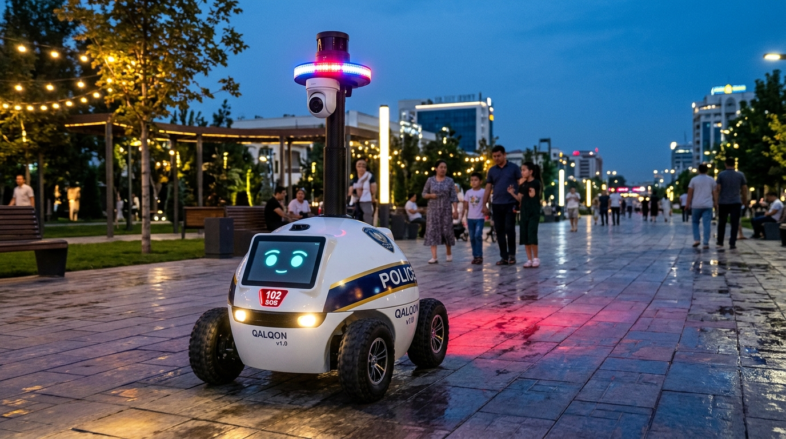
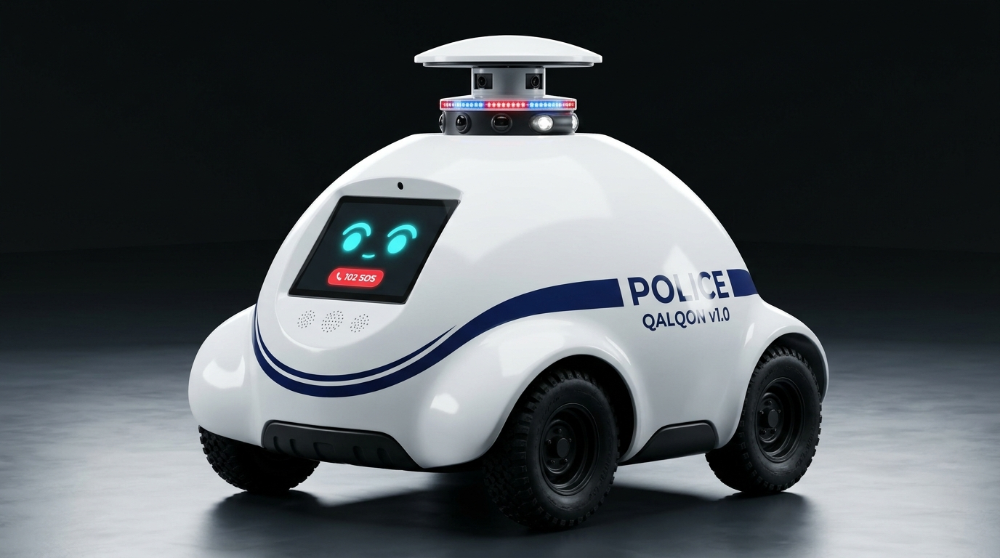
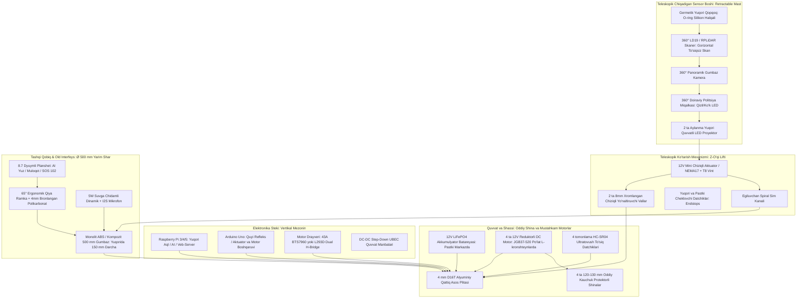

# ⚙️ QALQON v1.0 — Mexatronika va Apparat Konstruksiyasi Bo'yicha Yagona Rasmiy Hisobot va Ish Rejasi

> 👤 **Mas'ul muhandis (Kim):** Asilbek — Mexatronika va apparat konstruksiyasi bo'yicha bosh muhandis (Mechatronics & Hardware Lead)  
> 📅 **Oxirgi yangilanish (Qachon):** 01-Noyabr, 2026-yil | 22:05 (Toshkent vaqti, UTC+5)  
> 🔗 **Loyiha repozitoriysi:** [https://github.com/Asil2004/My-autnomius-car](https://github.com/Asil2004/My-autnomius-car)  
> 📌 **Eslatma:** Ushbu fayl loyihadagi **yagona rasmiy hisobot hujjati** hisoblanadi. Loyihada boshqa ortiqcha hisobot fayllari yuritilmaydi, barcha yangilanishlar faqat shu faylga kiritib boriladi.

---

## 🕒 QADAMMA-QADAM YANGILANISHLAR VA IJRO JURNALI (AUDIT LOG)

Quyidagi jadvalda loyiha davomida amalga oshirilgan har bir muhandislik yangilanishi, kim tomonidan va qaysi vaqtda bajarilgani qayd etib boriladi:

| № | Qachon (Sana va Vaqt) | Kim (Mas'ul xodim) | Bajarilgan vazifa va Yangilanish mazmuni | Holat / Natija |
| :---: | :---: | :---: | :--- | :---: |
| **01** | 2026-10-31 \| 14:38 | **Asilbek** (Mexatronika) | Boshlang'ich repozitoriy strukturasi yaratildi, Arduino drayveri va RPi boshqaruv kodlari yuklandi | `Bajarildi` |
| **02** | 2026-10-31 \| 15:02 | **Asilbek** (Mexatronika) | Yangi bosh standart tasdiqlandi: **QALQON v1.0 ($\varnothing 500\text{ mm}$ yarim shar gumbazli)** dizayni kiritildi | `Bajarildi` |
| **03** | 2026-10-31 \| 15:26 | **Asilbek** (Mexatronika) | Old qismga $65^\circ$ ergonomik qiyalikda 8.7" **AI kiber-ko'zlar va muloqot plansheti** (4mm polikarbonatli) loyihalashtirildi | `Bajarildi` |
| **04** | 2026-10-31 \| 15:41 | **Asilbek** (Mexatronika) | **Teleskopik yashirin minora (Retractable Mast)** mexanizmi kiritildi: sensorlar gumbaz ichidan elektr aktuator bilan $180\text{ mm}$ yuqoriga chiqadi | `Bajarildi` |
| **05** | 2026-10-31 \| 15:50 | **Asilbek** (Mexatronika) | Shassi Mecanumdan **4WD differensial oddiy kauchuk rezina shinalarga** ($\varnothing 120-130\text{ mm}$) va 12V DC reduktorli motorlarga o'tkazildi | `Bajarildi` |
| **06** | 2026-10-31 \| 15:54 | **Asilbek** (Mexatronika) | **Sfera (gumbaz) hajmi kattalashtirildi:** Gumbaz korpusi dominant qilinib, oddiy shinalar uning pastki arkalari ostiga mutanosib kiritildi | `Bajarildi` |
| **07** | 2026-10-31 \| 16:05 | **Asilbek** (Mexatronika) | Toshkent shahar piyodalar ko'chasida jamoat xavfsizligini ta'minlash sahnasi (Render) va **60 FPS jonli video-simulyator** yaratildi | `Bajarildi` |
| **08** | 2026-10-31 \| 16:55 | **Asilbek** (Mexatronika) | **Yagona hisobot standarti:** Takroriy fayllar tozalandi, har bir o'zgarishga "Kim va Qachon" audit tizimi joriy etildi | `Bajarildi` |
| **09** | 2026-10-31 \| 22:20 | **Asilbek** (Mexatronika & Tizim) | **Raspberry Pi 4 Avtonom OTA Auto-Updater & Watchdog:** GitHub'ga kod yangilanganda avtonom tortib olib, xizmatni qayta yuklovchi va nosozlikda avto-rollback qiluvchi systemd arxitekturasi joriy etildi | `Bajarildi` |
| **10** | 2026-10-31 \| 22:26 | **Asilbek** (Mexatronika & Jamoa) | **Apparat jamoasi kengaytirildi va vazifalar yuborildi:** Abduvali (`@Abduvali006` - Elektronika/PDB), Muhammadali (`@muhammad05092005` - Shassi/Rama) va Lazizbek (`@ali_ibn_tolib571` - Gumbaz/Minora)ga shaxsiy Telegram orqali vazifalar taqsimoti yetkazildi | `Bajarildi` |
| **11** | 2026-10-31 \| 22:38 | **Asilbek** (Mexatronika & Apparat) | **Kanonik 3D render va rasmiy CAD chizmasi (SVG) yaratildi:** Konstruktorlar Muhammadali va Lazizbekka o'lchamlar va shassi/gumbaz chizmalari, elektron muhandisi Abduvaliga 12V LiFePO4 quvvat ta'minoti va avto-zaryadlash stansiyasi talablari yuborilib, tasdiq va takliflar so'raldi | `Bajarildi` |
| **12** | 2026-10-31 \| 22:43 | **Asilbek** (Mexatronika & Jamoa) | **Boburjonga Telethon + Antigravity integratsiyasi qo'llanmasi yuborildi:** Shaxsiy Telegram (`@Boburjon2108`) orqali `my.telegram.org` API kalitlarini olish, sessiya yaratish va MCP server orqali Antigravity agentiga ulash yo'riqnomasi yetkazildi | `Bajarildi` |
| **13** | 2026-11-01 \| 21:50 | **Asilbek** (Mexatronika & Navigatsiya) | **Metrik masshtabdagi Virtual Model (Digital Twin), Planshet GPS integratsiyasi va 360° LiDAR avtonom patrul simulyatori yaratildi:** Planshet ichki GPS'ini WebSocket orqali ROS 2 / Pi ga uzatish va Google Maps ustida aniq masshtabli avtonom yurish mantiqi joriy etildi | `Bajarildi` |
| **14** | 2026-11-01 \| 22:04 | **Asilbek** (Mexatronika & Navigatsiya) | **Aqlli Ko'cha Navigatsiyasi (OSRM Smart Street Routing) joriy etildi:** Uylar va tomlar ustidan to'g'ri chiziqda uchib o'tish butunlay bartaraf etildi; robot xaritadagi real ko'cha va piyodalar yo'lagi (G'alaba, Amir Temur, Navoiy ko'chalari) bo'ylab burchaklarda burilib yuradigan qilindi va lokal server (port 8080) ishga tushirildi | `Bajarildi` |
| **15** | 2026-11-01 \| 23:25 | **Asilbek** (Mexatronika & Tizim) | **Frontend (Vite + React) GitHub Pages deploy tizimi joriy etildi:** TypeScript xatolari tuzatildi, nisbiy yo'llar (`base: './'`) sozlandi va avtomatik GitHub Actions CI/CD workflow (`deploy-pages.yml`) kiritildi | `Bajarildi` |
| **16** | 2026-11-01 \| 23:35 | **Asilbek** (Mexatronika & Tizim) | **Frontend UI ildiz katalogiga (`/index.html`, `/assets/`, `.nojekyll`) integratsiya qilindi:** GitHub Pages `main` yoki `gh-pages` sozlamasidan qat'i nazar, to'g'ridan-to'g'ri 3D kiber-HUD interfeysini ochadigan qilindi | `Bajarildi` |

---

## 📌 Asosiy Kanonik Dizayn Konsepsiyasi

Jamoamiz tomonidan tasdiqlangan bosh model: **QALQON v1.0 Police Patrol Robot Prototype**

*QALQON v1.0: Shahar piyodalar xiyobonida jamoat xavfsizligini ta'minlash jarayoni (Teleskopik minora, LiDAR va stroboskoplar faol holatda).*

 

*3D CAD Modeli: Katta hajmli dominant yarim shar gumbaz, uning ostida mutanosib joylashgan oddiy rezina shinalar va ochilgan teleskopik sensor minorasi.*

---

## 📐 Konstruktiv Talablar va Gabaritlar (Asilbek tomonidan tasdiqlangan)

* **Korpus shakli:** **$\varnothing = 500\text{ mm}$ Monolit Yarim shar (Smooth Hemisphere Dome)**. Tinch (patrul) holatida gumbaz yuzasida hech qanday ortiqcha chiqib turuvchi kamera, shox yoki mo'rt datchiklar bo'lmaydi — 100% silliq, zarbaga va yomg'irga chidamli aerodinamik qobiq.
* **Harakatlanish usuli (Oddiy shinalar va motorlar):** 
  * Murakkab va nozik rolikli Mecanum g'ildiraklari o'rniga **4 ta standart chuqur protektorli all-terrain kauchuk rezina shina ($\varnothing 120 - 130\text{ mm}$)** o'rnatiladi.
  * Har bir g'ildirakni **standart 12V DC metall reduktorli motor (JGB37-520 yoki PG45, 100–120 RPM, 15–20 kg·cm)** to'g'ridan-to'g'ri po'lat L-kronshteynlar orqali harakatga keltiradi.
  * Boshqaruv turi: **4WD Skid-Steer (Differensial / Tank burilishi)**. Ushbu shassi bruschatka, asfalt, tuproq va plitkalarda sirpanmaydi, qum-shag'al tiqilib qolmaydi va narxi ancha arzon hamda xizmat ko'rsatishga oson.
* **Teleskopik Yashirin Minora (Retractable Mast):** Faol kuzatuv yoki xavfli vaziyat yuzaga kelganda, gumbazning eng yuqori qopqog'i motorli **teleskopik lift mexanizmi orqali $150 - 200\text{ mm}$ yuqoriga ko'tariladi**. Ko'tarilgach, uning ichidan:
  * 360° LiDAR lazer skaneri (to'siqsiz gorizontal ko'rish maydoni bilan);
  * 360° Panoramik / PTZ gumbaz kamera;
  * 360° Politsiya stroboskopi (qizil/ko'k miltillovchi chiroqlar);
  * 2 dona quvvatli aylanma LED proyektorlar ochilib ishlaydi.
* **Old Interaktiv Planshet (AI & Muloqot):** Gumbazning old markaziy qismida **8.0 – 8.7 dyuymli sensorli planshet**. U sun'iy intellekt kiber-ko'zlari (mimika), fuqarolar bilan ovozli/matnli muloqot va **"SOS 102"** tezkor chaqiruv paneli vazifasini bajaradi. **$60^\circ - 65^\circ$ ergonomik qiyalikda**, 4 mm bronlangan polikarbonat oyna ortida joylashgan.
* **Tashqi o'lchamlar:** Eni: $450\text{ mm}$ | Bo'yi: $550\text{ mm}$ | Balandligi: Yopiq holatda $380\text{ mm}$, minora ochilganda $550\text{ mm}$.
* **Himoya darajasi:** Minora yopiq holatda **IP66**, ochilgan holatda **IP54** germetiklik standarti.

---

## 🏗️ Mexatronika Qismining Qavatma-Qavat (Exploded View) Arxitekturasi

---

## 🎯 Mexatronik Muhandisning Kelgusi Vazifalar Rejasi (Asilbek To-Do)

### 1. Oddiy Shinalar va Motorlar Montaji (4WD Differensial Shassi)
- [ ] **1.1.** 4 dona $\varnothing 120 - 130\text{ mm}$ kauchuk rezina g'ildiraklar uchun $12\text{ mm}$ geksagonal guruch adapterlarni o'rnatish.
- [ ] **1.2.** 4 ta 12V DC reduktorli motorni (JGB37-520) 3 mm po'lat L-kronshteynlarga bolt bilan mahkamlash.
- [ ] **1.3.** 4 mm D16T alyuminiy asos plitasining lazer kesish chizmasini (`DXF`) chiqarish.
- [ ] **1.4.** Klirensni ($45\text{ mm}$) piyodalar yo'lagidagi notekisliklarga nisbatan sinash.

### 2. Teleskopik Ko'tarish Mexanizmi (Z-Axis Retractable Mast)
- [ ] **2.1.** $150\text{ mm}$ stroke'ga ega 12V chiziqli aktuator va 2 ta $\varnothing 8\text{ mm}$ yo'naltiruvchi vallarning 3D CAD yig'masini tayyorlash.
- [ ] **2.2.** Yuqori va pastki chegara datchiklarini (Endstops) o'rnatish.
- [ ] **2.3.** Yuqori lyuk qopqog'iga O-ring silikon qistirmani montaj qilish.
- [ ] **2.4.** Ko'tariluvchi sensorlar uchun spiral sim zanjirini (Drag Chain) joylashtirish.

### 3. Old Planshet (AI & Muloqot) Konstruksiyasi
- [ ] **3.1.** 500 mm yarim sharning old qismida planshet uchun $65^\circ$ qiya ramkani (bezel) CAD modelda chizish.
- [ ] **3.2.** 4 mm polikarbonat himoya oynasi va planshet ekranining o'lchamlarini moslashtirish ($215 \times 130\text{ mm}$).
- [ ] **3.3.** Mikrofon va 5W dinamik panjarasini joylashtirish.

### 4. Korpus va Gumbaz Ishlab Chiqarish (Ø 500 mm Monolit Yarim Shar)
- [ ] **4.1.** 500 mm tashqi diametrli monolit yarim shar CAD 3D modelini (`STEP` / `STL`) tayyorlash.
- [ ] **4.2.** Gumbazni 3D printerda 4 ta segmentda chop etish yoki 3 mm ABS listdan vakuumli qolipda tortish.
- [ ] **4.3.** Yuqorida $\varnothing 150\text{ mm}$ teleskopik lyuk darchasini ochish.

### 5. Raspberry Pi 4 Avtonom Tizim va OTA (Over-The-Air) Avto-Yangilanish
- [x] **5.1.** `qalqon_brain.py` ga `/api/health` sog'lomlik monitoringi endpointi qo'shildi.
- [x] **5.2.** `qalqon_ota_updater.py` avtonom Git Watchdog daemon yaratildi (GitHub'dagi o'zgarishlarni 30s da tekshirish).
- [x] **5.3.** `qalqon-core.service` va `qalqon-updater.service` systemd fayllari ishlab chiqildi (Boot paytida avtostart va crash-proof auto-restart).
- [x] **5.4.** 🛡️ Anti-Brick avto-rollback tizimi kiritildi: yangi kod nosozlik bersa, avtomatik ravishda barqaror commitga qaytariladi.
- [x] **5.5.** `install_autonomous_services.sh` 1-bosqichli o'rnatish skripti tayyorlandi va [AVTONOM_YANGILANISH_VA_TIZIM_QOLLANMASI.md](docs/AVTONOM_YANGILANISH_VA_TIZIM_QOLLANMASI.md) hujjatlashtirildi.

---

## 🤝 Jamoa A'zolari Bilan Bog'lanish

* **Dasturiy ta'minot guruhi (Software Lead):** Shassi to'liq differensial boshqaruvda ishlaydi (`F`, `B`, `L`, `R`, `S`) va teleskopik minora buyruqlari (`U`, `D`).
* **Elektronika guruhi (Electronics Lead):** Har bir motor maksimal toki $3.2\text{ A}$, aktuator toki $2.0\text{ A}$, planshet quvvati doimiy $5\text{V } 3\text{A}$.

---

*Hujjat yurituvchisi: **Asilbek** (Mexatronika bosh muhandisi). Barcha o'zgarishlar faqat shu fayl orqali rasmiylashtiriladi.*
