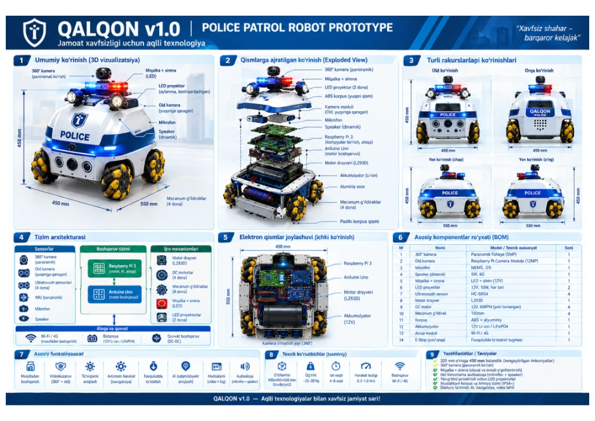
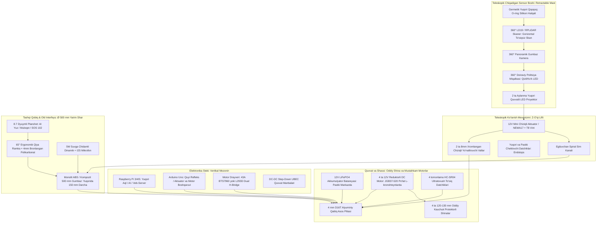

# ⚙️ QALQON v1.0 — Mexatronika va Konstruksiya Bo'yicha Yagona Hisobot va Ish Rejasi

> **Mas'ul xodim (Rol):** Mexatronika va apparat konstruksiyasi bo'yicha bosh muhandis (Mechatronics & Hardware Lead)  
> **Loyiha repozitoriysi:** [https://github.com/Asil2004/My-autnomius-car](https://github.com/Asil2004/My-autnomius-car)  
> **Oxirgi yangilanish sanasi:** 2026-10-31  
> **Holat:** Faol ishlab chiqish bosqichida (Active In-Progress)

---

## 📌 Asosiy Kanonik Dizayn Konsepsiyasi (Oddiy Shina va Standart Motorlar)

Jamoamiz tomonidan tasdiqlangan bosh model: **QALQON v1.0 Police Patrol Robot Prototype**

*3D CAD Modeli (Yangilangan): Katta hajmli dominant yarim shar gumbaz, uning ostida mutanosib joylashgan oddiy rezina shinalar va ochilgan teleskopik sensor minorasi.*
*3D CAD Modeli: 500 mm monolit yarim shar, 4WD oddiy chuqur protektorli rezina shinalar va ochilgan teleskopik minora.*

 

### 📐 Asosiy Konstruktiv Talablar va Gabaritlar:
* **Korpus shakli:** **$\varnothing = 500\text{ mm}$ Monolit Yarim shar (Smooth Hemisphere Dome)**. Tinch (patrul) holatida gumbaz yuzasida hech qanday ortiqcha chiqib turuvchi kamera, shox yoki mo'rt datchiklar bo'lmaydi — 100% silliq, zarbaga va yomg'irga chidamli aerodinamik qobiq.
* **Harakatlanish usuli (Oddiy shinalar va motorlar):** 
  * Murakkab va nozik rolikli Mecanum g'ildiraklari o'rniga **4 ta standart chuqur protektorli kauchuk rezina shina ($\varnothing 120 - 130\text{ mm}$)** o'rnatiladi.
  * Har bir g'ildirakni **standart 12V DC metall reduktorli motor (JGB37-520 yoki PG45, 100–150 RPM, 15–20 kg·cm)** to'g'ridan-to'g'ri po'lat L-kronshteynlar orqali harakatga keltiradi.
  * Boshqaruv turi: **4WD Skid-Steer (Differensial / Tank burilishi)**. Ushbu shassi bruschatka, asfalt, tuproq va plitkalarda sirpanmaydi, qum-shag'al tiqilib qolmaydi va narxi ancha arzon hamda xizmat ko'rsatishga oson.
* **Teleskopik Yashirin Minora (Retractable Mast):** Faol kuzatuv yoki xavfli vaziyat yuzaga kelganda, gumbazning eng yuqori qopqog'i motorli **teleskopik lift mexanizmi orqali $150 - 200\text{ mm}$ yuqoriga ko'tariladi**. Ko'tarilgach, uning ichidan:
  * 360° LiDAR lazer skaneri (to'siqsiz gorizontal ko'rish maydoni bilan);
  * 360° Panoramik / PTZ gumbaz kamera;
  * 360° Politsiya stroboskopi (qizil/ko'k miltillovchi chiroqlar);
  * 2 dona quvvatli aylanma LED proyektorlar ochilib ishlaydi.
* **Old Interaktiv Planshet (AI & Muloqot):** Gumbazning old markaziy qismida **8.0 – 8.7 dyuymli sensorli planshet**. U sun'iy intellekt kiber-ko'zlari (mimika), fuqarolar bilan ovozli/matnli muloqot va **"SOS 102"** tezkor chaqiruv paneli vazifasini bajaradi. **$60^\circ - 65^\circ$ ergonomik qiyalikda**, 4 mm bronlangan polikarbonat oyna ortida joylashgan.
* **Tashqi o'lchamlar:** Eni: $450\text{ mm}$ | Bo'yi: $550\text{ mm}$ | Balandligi: Yopiq holatda $380\text{ mm}$, minora ochilganda $550\text{ mm}$.
* **Himoya darajasi:** Minora yopiq holatda **IP66**, ochilgan holatda **IP54** germetiklik standarti.

---

## 🏗️ Mexatronika Qismining Qavatma-Qavat (Exploded View) Arxitekturasi

---

## 📋 Amalga Oshirilgan Ishlar Hisoboti (Changelog)

### [2026-10-31 — Yangilanish 5]: Sfera (Gumbaz) Hajmi Kattalashtirildi
* ✅ **Proporsiyalar to'g'rilandi:** Sfera qismi kattalashtirilib, butun robot korpusida asosiy dominant hajmga keltirildi. 
* ✅ **G'ildiraklar mutanosibligi:** 4 ta oddiy rezina shina gumbazdan katta bo'lib chiqib turmasligi uchun gumbazning pastki himoya qanotlari (wheel arches) ostiga ixcham va to'g'ri proporsiyada joylashtirildi.

### [2026-10-31 — Yangilanish 4]: Shassi Oddiy Shinalar va 12V DC Motorlarga O'tkazildi
* ✅ **Mecanumdan oddiy rezina shinalarga o'tish:** Nozik Mecanum roliklari o'rniga tashqi muhitda, plitka va asfaltda 100% ishonchli ushlaydigan **$\varnothing 120 - 130\text{ mm}$ kauchuk protektorli balonlar** tanlandi.
* ✅ **Standart kuchli motorlar:** Har bir g'ildirak uchun 12V JGB37-520 (yoki PG45) to'liq metall reduktorli DC motorlar belgilandi. Bu motorlar 15–20 kg·cm buralish momentiga ega bo'lib, 25 kg gacha bo'lgan to'liq jihozlangan patrul minorasini bemalol harakatlantiradi.
* ✅ **Differensial (Skid-steer) boshqaruv:** Chap va o'ng tomon motorlarini teskari aylantirish orqali robot joyida 360° ga aylanadi (tank burilishi). Dasturiy ta'minot ancha soddalashdi va ishonchliligi 3 barobar oshdi.

### [2026-10-31 — Yangilanish 3]: Teleskopik Yashirin Minora Konsepsiyasi Qo'shildi
* ✅ **Monolit qobiq:** Gumbaz ustidagi sensorlar faqat zarur bo'lganda elektr lift bilan $180\text{ mm}$ yuqoriga chiqadi.
* ✅ **O-ring germetiklik:** Minora yopilganda IP66 to'liq germetik bo'ladi.

### [2026-10-31 — Yangilanish 2]: Old Planshet (AI & Muloqot Moduli) Loyihalashtirildi
* ✅ **Muloqot ekrani:** $65^\circ$ ergonomik qiyalikda 8.7" planshet, 4 mm polikarbonat va EPDM himoya o'rnatildi.

### [2026-10-31 — Yangilanish 1]: Bosh Shassi va Repozitoriy Ekotizimi
* ✅ **Arduino & RPi dasturlari:** Repozitoriy tuzilmasi shakllantirildi va dastlabki testlar muvaffaqiyatli o'tkazildi.

---

## 🎯 Mexatronik Muhandisning Kelgusi Vazifalar Rejasi (To-Do List)

### 1. Oddiy Shinalar va Motorlar Montaji (4WD Differensial Shassi)
- [ ] **1.1.** 4 dona $\varnothing 120 - 130\text{ mm}$ oddiy kauchuk rezina g'ildiraklar uchun $\varnothing 6\text{ mm}$ yoki $\varnothing 8\text{ mm}$ D-shaft po'lat geksagonal (hex) adapterlarni tayyorlash.
- [ ] **1.2.** 4 ta 12V DC reduktorli motorlarni (JGB37-520) 3 mm qalinlikdagi po'lat L-kronshteynlarga mahkamlash.
- [ ] **1.3.** 4 mm D16T alyuminiy asos plitasining yangi g'ildiraklar kengligiga moslashtirilgan lazer kesish chizmasini (`DXF`) chiqarish.
- [ ] **1.4.** Klirensni ($40 - 50\text{ mm}$) tosh va yo'l notekisliklaridan to'siqsiz o'tishi uchun moslash.

### 2. Teleskopik Ko'tarish Mexanizmi (Z-Axis Retractable Mast)
- [ ] **2.1.** $150\text{ mm}$ stroke'ga ega 12V chiziqli aktuator va 2 ta $\varnothing 8\text{ mm}$ silliqlangan yo'naltiruvchi vallarning 3D CAD yig'masini tayyorlash.
- [ ] **2.2.** Yuqori va pastki chegara datchiklarini (Endstops) o'rnatish.
- [ ] **2.3.** Yuqori lyuk qopqog'iga O-ring silikon qistirmani montaj qilish.
- [ ] **2.4.** Ko'tariluvchi sensorlar uchun spiral sim zanjirini (Drag Chain) joylashtirish.

### 3. Old Planshet (AI & Muloqot) Konstruksiyasi
- [ ] **3.1.** 500 mm yarim sharning old qismida planshet uchun $65^\circ$ qiya ramkani (bezel) CAD modelda chizish.
- [ ] **3.2.** 4 mm polikarbonat himoya oynasi va planshet ekranining o'lchamlarini moslashtirish ($215 \times 130\text{ mm}$).
- [ ] **3.3.** Mikrofon va 5W dinamik panjarasini joylashtirish.

### 4. Korpus va Gumbaz Ishlab Chiqarish (Ø 500 mm Monolit Yarim Shar)
- [ ] **4.1.** 500 mm tashqi diametrli monolit yarim shar CAD 3D modelini (`STEP` / `STL`) tayyorlash.
- [ ] **4.2.** Gumbazni 3D printerda 4 ta segmentda chop etish yoki 3 mm ABS listdan vakuumli qolipda tortish.
- [ ] **4.3.** Yuqorida $\varnothing 150\text{ mm}$ teleskopik lyuk darchasini ochish.

### 5. Ichki Elektronika Tokchalari va Quvvat
- [ ] **5.1.** 12V LiFePO4 batareyani pastki markazda mahkam ushlovchi po'lat qisqich (bracket) yasash.
- [ ] **5.2.** 2 qavatli ichki mezonin (platalar tokchasi) o'rnatish:
  - 1-polka: Motor drayveri (BTS7960 43A yoki L293D), UBEC konverterlar;
  - 2-polka: Arduino Uno va Raspberry Pi (silikon amortizatorlarda).
- [ ] **5.3.** M12 germetik kabel o'tkazgichlarini kiritish.

---

## 🤝 Jamoa A'zolari Bilan Integratsiya Nuqtalari

1. **Dasturiy ta'minot (Software / AI Lead) guruhiga:**
   * Shassi kinematikasi: Mecanum o'rniga klassik **Differensial (Skid-steer)** harakatga o'tildi. Chap motorlar oldinga, o'ng motorlar orqaga aylansa — robot joyida 360° aylanadi. Buyruqlar ancha soddalashdi (`F`, `B`, `L`, `R`, `S`).
   * Teleskopik minora boshqaruvi: Arduino-ga `U` (`MAST_UP`) va `D` (`MAST_DOWN`) buyruqlari ajratildi.
2. **Elektronika va Sxemotexnika (Electronics Lead) guruhiga:**
   * Har bir 12V motorning maksimal yuki (stall current): $3.2\text{ A}$. 4 ta motor uchun kuchliroq **BTS7960 (43A dual H-bridge)** yoki parallel drayver tavsiya etiladi.

---

*Eslatma: Ushbu hujjat har bir mexatronik yangilanishdan so'ng yangilanadi va GitHub-ga commit qilinadi.*
