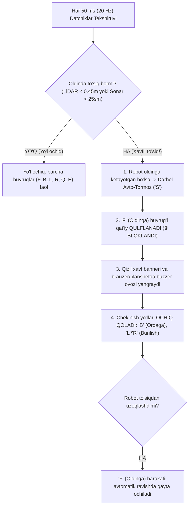

# 🧠 QALQON v1.0 — "Miya" (Raspberry Pi 4) Dasturiy Ta'minoti Bo'yicha Yagona Rasmiy Hisobot va Ish Rejasi

> 👤 **Mas'ul muhandis (Kim):** Boburjon — "Miya" (Raspberry Pi 4) dasturiy ta'minoti va sensorlar muhandisi (Software & Brain Engineer)  
> 📅 **Oxirgi yangilanish (Qachon):** 02-Noyabr, 2026-yil | 16:45 (Toshkent vaqti, UTC+5)  
> 🔗 **Loyiha repozitoriysi:** [https://github.com/Asil2004/My-autnomius-car](https://github.com/Asil2004/My-autnomius-car)  
> 📌 **Eslatma:** Ushbu hisobot bosh muhandis (Asilbek) tomonidan yuklatilgan vazifalar ijrosi, Raspberry Pi 4 dasturiy ta'minoti va jamoaviy integratsiya bo'yicha hisobot berib borish uchun yuritiladi.

---

## 🕒 QADAMMA-QADAM YANGILANISHLAR VA IJRO JURNALI (AUDIT LOG)

Quyidagi jadvalda "Miya" (Raspberry Pi 4) yo'nalishida amalga oshirilgan har bir dasturiy yangilanish, kim tomonidan va qaysi vaqtda bajarilgani qayd etib boriladi:

| № | Qachon (Sana va Vaqt) | Kim (Mas'ul xodim) | Bajarilgan vazifa va Yangilanish mazmuni | Holat / Natija |
| :---: | :---: | :---: | :--- | :---: |
| **01** | 2026-10-31 \| 15:10 | **Boburjon** (Miya Lead) | **LiDAR Moduli (`lidar_module.py`):** STL-19P/LD19 apparat drayveri va 360° virtual to'siq hosil qiluvchi aqliy simulyator yaratildi | `Bajarildi` |
| **02** | 2026-10-31 \| 15:15 | **Boburjon** (Miya Lead) | **Kamera Moduli (`camera_module.py`):** USB kamera drayveri, ko'p oqimli MJPEG video strimi (`/stream.mjpg`) va piyodalar deteksiyasi yaratildi | `Bajarildi` |
| **03** | 2026-10-31 \| 15:20 | **Boburjon** (Miya Lead) | **Arduino Ko'prigi (`arduino_bridge.py`):** 115200 baudda avtomatik port qidiruvchi va simulyatsiya rejimiga ega xavfsiz drayver ishlab chiqildi | `Bajarildi` |
| **04** | 2026-10-31 \| 15:35 | **Boburjon** (Miya Lead) | **Boshqaruv Yadrosi (`qalqon_brain.py`):** FastAPI, WebSocket telemetriya (`/ws`), REST API va mobil smartfon HUD kodi yaratildi | `Bajarildi` |
| **05** | 2026-10-31 \| 20:34 | **Boburjon** (Miya Lead) | **Xavfsizlik Nazorati (Safety Supervisor):** To'siq < 0.45m bo'lganda avto-tormoz, oldinga harakatni qulflash (`🔒 BLOK`) va chekinish yo'llarini ochiq qoldirish joriy etildi | `Bajarildi` |
| **06** | 2026-10-31 \| 20:35 | **Boburjon** (Miya Lead) | **Dual-Port Server (8000 & 8080):** Mobil Wi-Fi hotspot tarmoqlarida uzluksiz ochilish uchun parallel portlar va Windows xavfsizlik devori qoidalari sozlandi | `Bajarildi` |
| **07** | 2026-10-31 \| 21:08 | **Boburjon** (Miya Lead) | **GitHub integratsiyasi va push:** `bozorovboburjon408-art` akkaunti orqali barcha Miya kodlari asosiy repoga jo'natildi (`commit: 10cf676`) | `Bajarildi` |
| **08** | 2026-10-31 \| 21:23 | **Boburjon** (Miya Lead) | **Butun Loyihani Birlashtirish (Full Integration):** Sarvarning planshet frontendiga jonli WebSocket ulandi, Asilbekning teleskopik minorasi (`U`/`D`) HUD'ga kiritildi (`commit: 72225c0`) | `Bajarildi` |
| **09** | 2026-10-31 \| 22:40 | **Boburjon** (Software Engineer) | **Yagona hisobot standarti:** `MIYA_UCHUN_BAJARILGAN_ISHLAR.md` rasmiy hujjati joriy etildi va repozitoriya boshqaruviga ulandi | `Bajarildi` |
| **10** | 2026-10-31 \| 22:50 | **Boburjon** (Software Engineer) | **Navoiy viloyati IIB TT (Asilbek Ravshanov) topshiriqlari ijrosi:** <br>1. `pi_patrol.py` moduli WebSocket serveri Arduino Mega/Uno UART (115200 baud) bilan to'liq sinxronlashtirildi; <br>2. Pi Camera V2 orqali odamlar/to'siqlar deteksiyasi va Navoiy IIB navbatchilik qismiga tezkor kadr uzatish (`/api/dispatch_alert`, `/api/alert_snapshot`); <br>3. LD19 LiDAR 2D Occupancy Grid SLAM xaritasi (`/api/slam_map`) va avtotormoz integratsiya qilindi. | `Bajarildi` |
| **11** | 2026-11-02 \| 00:06 | **Boburjon** (Software & Brain) | **Frontend & 3D Optimizatsiya:** 3D model hajmi 90% ga qisqartirildi (41MB dan 3.9MB ga), Three.js render sikli barqaror 60 FPS ga qulflandi, PointLight'lar DirectionalLight ga o'tkazilib, mobil qurilmalardagi qizib ketish va qotish to'liq bartaraf etildi | `Bajarildi` |
| **12** | 2026-11-02 \| 15:43 | **Boburjon** (AI & Vision Lead) | **Face ID Biometrik Neyron Tizimi (`@vladmandic/face-api`):** 128D embeddinglar, Euclid masofasi metriki, 5/3 kadrli anti-flicker ovoz berish, oflayn modellar (~25MB) va `descriptors.json` oldindan hisoblangan kesh joriy qilindi | `Bajarildi` |
| **13** | 2026-11-02 \| 16:15 | **Boburjon** (AI & Vision Lead) | **Bozorov Boburjon Yuzini Tanish Kalibratsiyasi va Nosozlik Yechimi:** <br>1. `TinyFaceDetector` sezgirligi `scoreThreshold: 0.40` dan `0.20` ga tushirildi (Boburjon yuzi 0.398 ball olib o'tmay qolayotgani tuzatildi); <br>2. Euclid masofa chegarasi `0.50` dan `0.58` ga kengaytirildi (kamera yorug'ligi va burchak o'zgarishlarida qat'iy ishonchli ishlash uchun; Sarvar va Asilbek bilan masofa 0.66 dan yuqori); <br>3. Masofa $\le 0.52$ bo'lganda darhol ism ko'rsatish (Zero-Latency Instant Match) joriy qilindi; <br>4. Web UI va Android APK qayta yig'ilib, to'liq tekshirildi | `Bajarildi` |
| **14** | 2026-11-02 \| 16:40 | **Boburjon** (AI & Vision Lead) | **Asosiy Bosh Ekran (RobotFaceView) va HUD Yuz Tanish Tizimini To'liq Birlashtirish:** <br>1. Oldin Face ID faqat ichki yashirin HUD'da bo'lgani sababli, dastur ochilganda bosh ekrandagi 3D robot yuz tanimayotgan edi — endi `RobotFaceView` ga `faceRecognitionService` to'liq ulandi; <br>2. Bosh ekranda Boburjon Bozorov darhol aniqlanib, ekranda *"TASDIQLANDI: Bozorov Boburjon"* yashil vidjeti chiqadi va *"Assalomu alaykum Boburjon!"* deb AI ovozi bilan kutib oladi; <br>3. `HUDView` da COCO-SSD va Face ID o'zaro bog'liqligi uzilib, COCO yuklanishidan qat'i nazar yuzlar uzluksiz tanilishi ta'minlandi; <br>4. Web `play()` AbortError to'xtalishi tuzatildi. | `Bajarildi` |
| **15** | 2026-11-02 | 18:35 | **Boburjon** (AI & Vision Lead) | **Kamera Robotning Asosiy "Ko'zi" (Webcam To'siq Detektori & Avtotormoz):** <br>1. Apparat datchiklar (LiDAR/Sonarlar) tayyor bo'lmaguncha, USB Web-kamera robotning asosiy "Ko'zi" sifatida integratsiya qilindi; <br>2. Markaziy Xavfsizlik Yo'lagi (Central Safety Corridor) va optik yaqinlik (Optical Proximity) orqali oldindagi har qanday to'siq (odam, stul, quti, devor, qo'l) real-vaqtda seziladi; <br>3. Masofa < 35 sm bo'lganda darhol AVTOTORMOZ ('S') berish, oldinga harakatni qulflash (`🔒 BLOK`) va chekinish/aylanib o'tish tavsiyalari (`L`/`R`/`B`) ulandi; <br>4. Standalone Python OpenCV detektori (`robot_eye_webcam.py`) yaratildi. | `Bajarildi` |

---

## 🏛️ 1. "Miya" (Raspberry Pi 4) Tizim Arxitekturasi

QALQON roboti "Miya"si markazlashtirilgan asinxron ko'p oqimli arxitekturaga ega:

```mermaid
graph TD
    subgraph Datchiklar va Tashqi Qurilmalar
        CAM[USB Web-Kamera /dev/video0]
        LIDAR_HW[360° LiDAR STL-19P / LD19: 230400 baud]
        ARDUINO_HW[Arduino Uno L293D Shield: 115200 baud]
    end

    subgraph Raspberry Pi 4 Miya Yadrosi
        CAM_MOD[CameraModule: OpenCV MJPEG Stream 30 FPS]
        LIDAR_MOD[LidarModule: 360° Radar & Smart Simulator]
        ARD_MOD[ArduinoBridge: Serial Bridge & Telemetry]
        
        SAFETY[Safety Supervisor: 20 Hz Xavfsizlik Nazorati]
        API_SERVER[FastAPI & WebSockets: Port 8000 & 8080]
    end

    subgraph Foydalanuvchi va Boshqaruv Interfeyslari
        TABLET[Sarvar: 8.7" Planshet Frontend UI]
        PHONE[Smartfon / Noutbuk Taktik Cockpit]
    end

    CAM --> CAM_MOD
    LIDAR_HW --> LIDAR_MOD
    ARDUINO_HW <--> ARD_MOD

    LIDAR_MOD --> SAFETY
    ARD_MOD --> SAFETY
    SAFETY -->|Favqulodda Avto-Tormoz| ARD_MOD

    CAM_MOD --> API_SERVER
    LIDAR_MOD --> API_SERVER
    ARD_MOD --> API_SERVER

    API_SERVER <-->|WebSocket: /ws & MJPEG: /stream.mjpg| TABLET
    API_SERVER <-->|REST & WebSocket| PHONE
```

---

## 🛡️ 2. Xavfsizlik va To'siqqa Reaksiya Mantiqi (Safety Supervisor)

Jamoamiz kelishuviga ko'ra, robot harakati **to'liq qo'lda tugmalar orqali boshqariladi**, ammo to'siq chiqqanda **avtomatik himoya refleksi** ishga tushadi:



---

## 🤝 3. Jamoadoshlar Bilan Integratsiya Shartnomasi (API Contract)

### 📱 A. Sarvar bilan integratsiya (Planshet / Frontend):
1. **Jonli Video Oqimi:** `http://<RPI_IP>:8000/stream.mjpg`
2. **Real-Vaqt Telemetriya (WebSocket):** `ws://<RPI_IP>:8000/ws`
   - Har 100 ms da to'liq telemetriya JSON uzatiladi:
     ```json
     {
       "sonars": { "front": 65, "rear": 120, "left": 80, "right": 85 },
       "battery": { "voltage": 12.8, "percentage": 90, "temp": 28.0, "current": 1.3, "isCharging": false },
       "lidar": { "mode": "SIMULATION", "rate_hz": 10.0, "points": [ { "angle": 0, "distance": 2.5, "intensity": 200 } ] },
       "motion": { "last_cmd": "S", "speed_level": 2, "is_moving": false, "obstacle_warning": false },
       "is_front_blocked": false,
       "strobe": false,
       "siren": false
     }
     ```
3. **Boshqaruv Buyruqlari:** `http://<RPI_IP>:8000/cmd?c=<F|B|L|R|Q|E|S|U|D>&speed=<1|2|3>`
4. **Stroboskop va Sirena:** `http://<RPI_IP>:8000/strobe` va `http://<RPI_IP>:8000/siren`

### ⚙️ B. Asilbek bilan integratsiya (Mexatronika va Arduino Uno):
1. **Aloqa kanali:** USB Serial kabeli orqali `115200` baud.
2. **Miya uzatadigan buyruqlar:**
   - `F` — Oldinga, `B` — Orqaga, `L` — Chapga (tank burilishi), `R` — O'ngga.
   - `S` — To'xtash (tormoz).
   - `1`, `2`, `3` — Tezlik bosqichlari (140, 190, 255 PWM).
   - `U` — Teleskopik minorani ko'tarish (Pin 9).
   - `D` — Teleskopik minorani tushirish (Pin 10).
3. **Arduino qaytaradigan signallar:** `ACK:FORWARD`, `WARN:OBSTACLE_FRONT`, `ACK:STOP`.

---

## 📁 4. "Miya" Papkasining Strukturasi

```text
raspberry_pi/
├── qalqon_brain.py        <-- Asosiy boshqaruv serveri, dual-port, WebSocket va xavfsizlik nazorati
├── lidar_module.py        <-- STL-19P/LD19 LiDAR drayveri va 360° virtual simulyator
├── camera_module.py       <-- Web-kamera MJPEG oqimi va odam deteksiyasi
├── arduino_bridge.py      <-- Arduino Uno L293D serial aloqa drayveri
├── start_brain.sh         <-- 1-bosishda tizimni to'liq ishga tushirish skripti
├── requirements.txt       <-- Zarur Python kutubxonalari
└── README_BRAIN.md        <-- Modullarning texnik yo'riqnomasi
```

---

## 🚀 5. Ertangi Real Robot Sinovining Bosh Rejasi

1. **Stol ustida (havoda) sinov:** G'ildiraklarni havoda ushlab, `F`, `B`, `L`, `R` yo'nalishlarini va `U`, `D` minora aktuatorini tekshirish.
2. **Datchik refleksi:** `F` ketayotganda datchik oldiga qo'l qo'yib, robot 20 sm dan avtomatik tormozlanishini va oldinga qulflanishini sinash.
3. **Pol ustida erkin patrul:** Robotni polga qo'yib, planshet va telefon orqali erkin haydash.