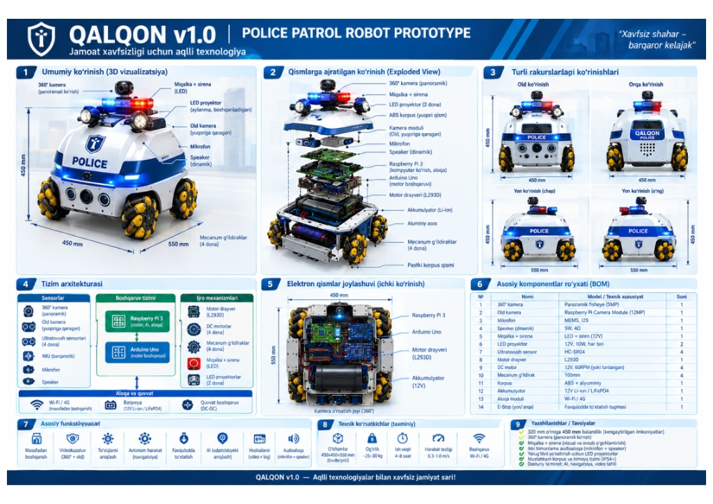
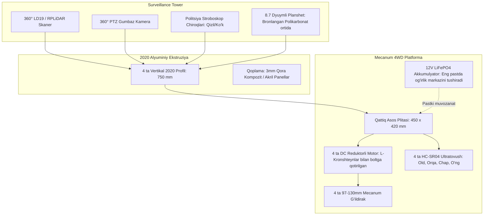
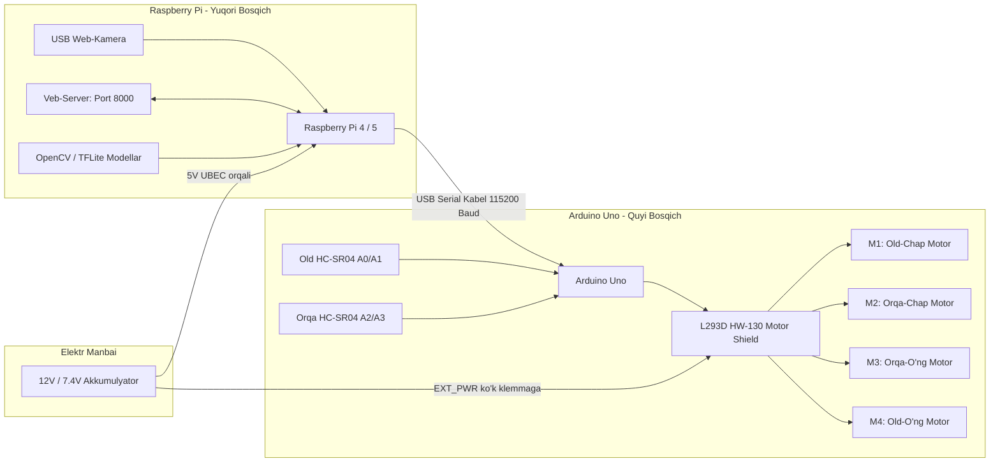
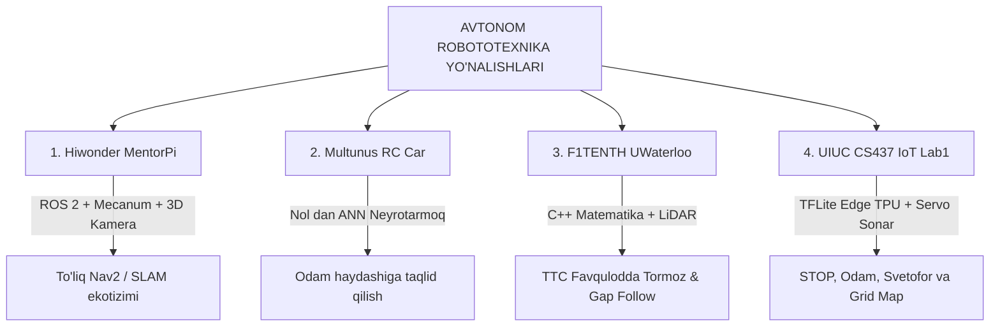

# 🛡️ "QALQON v1.0" IIV Avtonom Patrul Roboti: Yagona Jamlangan Texnik Qo'llanma



> 📌 **Mexatronika va Apparat Bo'yicha Bosh Hujjat:**  
> Konstruktsiya chizmalari, hisobotlar va kelgusi reja: **👉 [`MEXATRONIKA_HISOBOT_VA_REJA.md`](MEXATRONIKA_HISOBOT_VA_REJA.md)**

---

## MUNDARIJA

1. **Loyiha Konsepsiyasi va Vazifasi**
2. **Mexanik Konstruksiya (Talaba / DIY Amortizatorsiz Shassi)**
3. **Elektronika va Uskunalar Arxitekturasi**
4. **Dasturiy Ta'minot va Sinov Qadamlari (Arduino + Raspberry Pi)**
5. **Kamera orqali Masofani O'lchash va Yo'lni Ko'rish Metodlari**
6. **4 ta Global Loyiha Tahlili va "Qalqon"ga Integratsiyasi**
7. **Bosqichma-bosqich Amaliy Yo'l Xaritasi (Roadmap)**

---

## 1. Loyiha Konsepsiyasi va Vazifasi

* **Nomi:** "Qalqon" Avtonom Patrul va Jamoat Xavfsizligi Roboti.
* **Maqsadi:** Piyodalar yo'laklari, istirohat bog'lari, xiyobonlar va ta'lim maskanlarida patrullik qilish, yo'l qoidalariga rioya etilishini kuzatish, to'siqlarni chetlab o'tish va favqulodda vaziyatlarda fuqarolarga **"SOS 102"** tezkor yordam aloqasini taqdim etish.
* **Form-faktori:** Vertikal kuzatuv minorasi (balandligi ~1.15 m, asosi 45x45 sm), kiber-ko'rinishdagi jiddiy va sergak dizayn.

---

## 2. Mexanik Konstruksiya (Talaba / DIY Amortizatorsiz Shassi)

Talaba yoki laboratoriya sharoitida murakkab va qimmatbaho podveska (amortizatorlar) ishlatmasdan, qattiq karkasda ishonchli ishlash uchun quyidagi yechim tanlandi:



### Muhim Mexanik Qoidalar:
1. **Nega Amortizatorsiz?** Baland minora (1.15m) harakatlanganda va to'xtaganda prujinalar sabab chayqalib ketmaydi. LiDAR xaritasi va PTZ kamera gorizonti doimo barqaror turadi.
2. **Mecanum g'ildiraklar:** Robot joyida 360° burilish va burilmasdan yonboshga (Strafe) harakatlanish imkoniyatiga ega. G'ildiraklar yuqoridan qaralganda roliklari **`X`** shaklini hosil qilishi shart.
3. **Vandalga qarshi himoya:** Planshet tashqaridan emas, ichki tomondan 4 mm Lexan (polikarbonat) oyna ortiga o'rnatiladi. Tashqi korpusda yechiladigan ochiq vintlar bo'lmaydi.

---

## 3. Elektronika va Uskunalar Arxitekturasi

Tizim ikki bosqichli "Miya + Refleks" arxitekturasida ishlaydi:



### Uskunalarni Ulagichlar Jadvali:

| Uskuna / Modul | Ulanish Nuqtasi | Belgilanishi / Pin | Vazifasi |
| :--- | :--- | :--- | :--- |
| **Arduino -> RPi** | USB-A dan USB-B kabel | `/dev/ttyACM0` (115200) | Buyruqlar va xavf signallari almashinuvi |
| **Old HC-SR04** | L293D Shield A0 va A1 | `Trig = A0`, `Echo = A1` | Old to'siqni o'lchash (Favqulodda tormoz) |
| **Orqa HC-SR04** | L293D Shield A2 va A3 | `Trig = A2`, `Echo = A3` | Orqaga harakatda to'siqni aniqlash |
| **4 ta DC Motor** | L293D vintli klemmalari | `M1`, `M2`, `M3`, `M4` | 4WD Mecanum mustaqil harakatlantirish |
| **Akkumulyator** | L293D `EXT_PWR` klemmasi | `+` va `-` (GND) | Motorlarga yuqori tok yetkazish |
| **Sariq Jumper** | L293D ustidagi `PWR` | **SUG'URIB OLINADI** | Arduino va motor quvvatini ajratish |

---

## 4. Dasturiy Ta'minot va Sinov Qadamlari

### A. Arduino Sketch: `arduino_l293d_patrol.ino`
* Joylashuvi: [`d:\antigravity\qalqon\arduino_l293d_patrol\arduino_l293d_patrol.ino`](file:///d:/antigravity/qalqon/arduino_l293d_patrol/arduino_l293d_patrol.ino)
* Vazifasi: `AFMotor.h` kutubxonasi orqali motorlarni boshqaradi.
* Serial buyruqlar protokoli:
  * `'F'` — Oldinga, `'B'` — Orqaga, `'L'` — Chapga, `'R'` — O'ngga
  * `'Q'` — Chapga yonlama (Strafe), `'E'` — O'ngga yonlama (Strafe)
  * `'S'` — To'xtash
  * `'1'`, `'2'`, `'3'` — Tezlikni almashtirish (130, 190, 250 PWM)
* Xavfsizlik sharti: Agar old masofa `< 22 sm` bo'lsa, harakat to'xtatiladi va `WARN:OBSTACLE_FRONT` signali qaytariladi.

### B. Raspberry Pi Veb-Kontroller: `pi_patrol.py`
* Joylashuvi: `~/qalqon/pi_patrol.py` (Raspberry Pi ichida)
* Web-interfeys: `http://10.37.227.167:8000`
* Imkoniyatlari:
  * Jonli video stream (MJPEG).
  * 9 ta virtual sensorli tugma (Mecanum barcha yo'nalishlari).
  * Klaviatura tugmalari orqali boshqaruv (`W`, `A`, `S`, `D`, `Q`, `E`, `Space`).
  * `AUTO_CAMERA` va `MANUAL` rejimlari orasida almashish.

---

## 5. Kamera orqali Masofani O'lchash va Yo'lni Ko'rish

Oddiy bitta (monokulyar) USB kamera orqali masofani aniqlashning 3 xil professional usuli:

1. **Geometrik / Fokus formulasi (Known Object Size):**
   $$\text{Masofa } (D) = \frac{\text{Haqiqiy Kenglik } (W) \times \text{Fokus Masofasi } (F)}{\text{Kadrda Egallagan Piksellar } (P)}$$
   * Agar inson yuzi kadrda 150 piksel bo'lsa ~1 m, 50 piksel bo'lsa ~3 m.
2. **ArUco / AprilTag markerlari:**
   * Bazaga yoki to'siqqa maxsus 2D kvadrat kod yopishtiriladi. OpenCV uning burchaklaridan 1 sm aniqlikda masofani hisoblaydi.
3. **Datchiklar Birlashmasi (Sensor Fusion - Eng to'g'ri yo'l):**
   * Kamera yo'nalish va chiziqni topadi (Aql), ultratovush datchik esa oldidagi to'siqqacha aniq masofani o'lchab darhol to'xtatadi (Refleks).

---

## 6. To'rtta Global Loyiha Tahlili va "Qalqon"ga Moslashtirish

Siz taqdim etgan va o'rganilgan barcha tizimlar taqqoslamasi:



### 1. Hiwonder MentorPi M1 (ROS 2 / Raspberry Pi 5 / Mecanum)
* **Xususiyati:** Sizning shassingiz bilan 100% bir xil Mecanum kinematikasi.
* **Foydali tomoni:** Yuqori darajadagi SLAM (xaritalash) va Nav2 avtopiloti uchun tayyor namuna.

### 2. Multunus Autonomous RC Car (End-to-End Artificial Neural Network)
* **Xususiyati:** TensorFlow yoki PyTorch-siz, toza matematikada (bitta yashirin qatlamli neyrotarmoq) yozilgan.
* **Foydali tomoni:** Robotni 5 daqiqa o'zingiz haydaysiz, u rasmlar va bosilgan tugmalarni yozib oladi va keyin xuddi sizdek mustaqil haydashni o'rganadi.

### 3. F1TENTH (University of Waterloo, CL2 Lab)
* **Xususiyati:** 25 km/soat tezlikda to'qnashuvsiz poyga qiluvchi ROS 2 paketi.
* **Foydali tomoni:**
  * **`safety_node` (TTC - Time to Collision):** Tezlik va masofa nisbati orqali avtomatik favqulodda tormoz.
  * **`gap_follow` (Follow the Gap):** To'siqlar orasidagi eng katta bo'sh yo'lni topib, to'xtamasdan aylanib o'tish.

### 4. UIUC CS 437 IoT Lab 1 (Tesla Model S miniatyurasi)
* **Xususiyati:** Kichik `road_signs_quantized_edgetpu.tflite` modeli orqali:
  * `Person` (Odam)
  * `Stop` (STOP belgisi)
  * `Red` / `Green` (Svetofor)
  * `Limit 25` / `Limit 40` (Tezlik cheklovlari)
* **Foydali tomoni:** Raspberry Pi-da soniyasiga 20–30 kadrda qotmasdan ishlaydi va kompyuteringizdagi `d:\antigravity\qalqon\cs437_iot_lab1` papkasida barcha modellari tayyor holda turibdi.

---

## 7. Bosqichma-bosqich Amaliy Yo'l Xaritasi (Roadmap)

```
[1-BOSQICH (Hozirgi erishilgan natija)]
   ✅ Mecanum shassi + L293D + Arduino Uno
   ✅ Raspberry Pi veb-strimi (8000-port)
   ✅ Klaviaturadan va tugmalardan boshqaruv
   ✅ Ultratovushli xavfsizlik to'xtashi

[2-BOSQICH (Eng yaqin qadam)]
   🔹 Kamerani 35-40° burchak ostida polga qaratish
   🔹 UIUC loyihasidagi 'road_signs_quantized.tflite' modelini ulash
   🔹 Odam va qizil STOP belgisini ko'rganda avtomatik to'xtash

[3-BOSQICH (O'rta bosqich)]
   🔹 Multunus uslubida klaviaturadan ma'lumot yig'ish va o'rgatish
   🔹 Servo motorga bitta ultratovushni o'rnatib mini-radar qilish

[4-BOSQICH (Yakuniy IIV Patrul Minorasi)]
   🔹 2020 Alyuminiy vertikal minora karkasini yig'ish
   🔹 Planshet (102 SOS chaqiruv paneli) va politsiya stroboskopini integratsiya qilish
   🔹 LD19 LiDAR qo'shib to'liq SLAM xaritasini ishga tushirish
```


---

## 8. Zamonaviy Taktik Frontend & Android Mobil APK

Robotni boshqarish va uning telemetriyasini real-vaqtda kuzatish uchun maxsus **Mission Control Tactical UI** ishlab chiqildi:
* **Texnologiyalar**: React 19, TypeScript, Tailwind CSS, Lucide Icons, Capacitor Android.
* **Asosiy Modullar**:
  * **Boshqaruv HUD**: 8 yo'nalishli Mecanum pulti (`W, A, S, D, Q, E, Space, 1-3`), 360° PTZ gumbaz kamera nazorati, 4x HC-SR04 sonarlar va avtotormoz (`WARN:OBSTACLE_FRONT`).
  * **SOS 102 Terminali**: 8.7" bronlangan minora ekrani uchun gigant favqulodda chaqiruv, stroboskop va dispetcherlik interfeysi.
  * **AI & Avtonom Patrul**: Edge TFLite ob'ektlar deteksiyasi (Odam, STOP, Svetofor, Tezlik belgilari), F1TENTH Gap-Follow va TTC (Time to Collision) hisoblagichi.
  * **360° LiDAR Radar Canvas**: LD19 / RPLiDAR skaneri uchun real-vaqtdagi radar sweep vizualizatsiyasi.
  * **Android APK**: `qalqon-patrol-v1.0.apk` sifatida to'liq yig'ilgan va smartfon/planshetlarga o'rnatishga tayyor.
* **Batafsil Hisobot**: [UI_uchun_bajarilgan_ishlar.md](UI_uchun_bajarilgan_ishlar.md)
