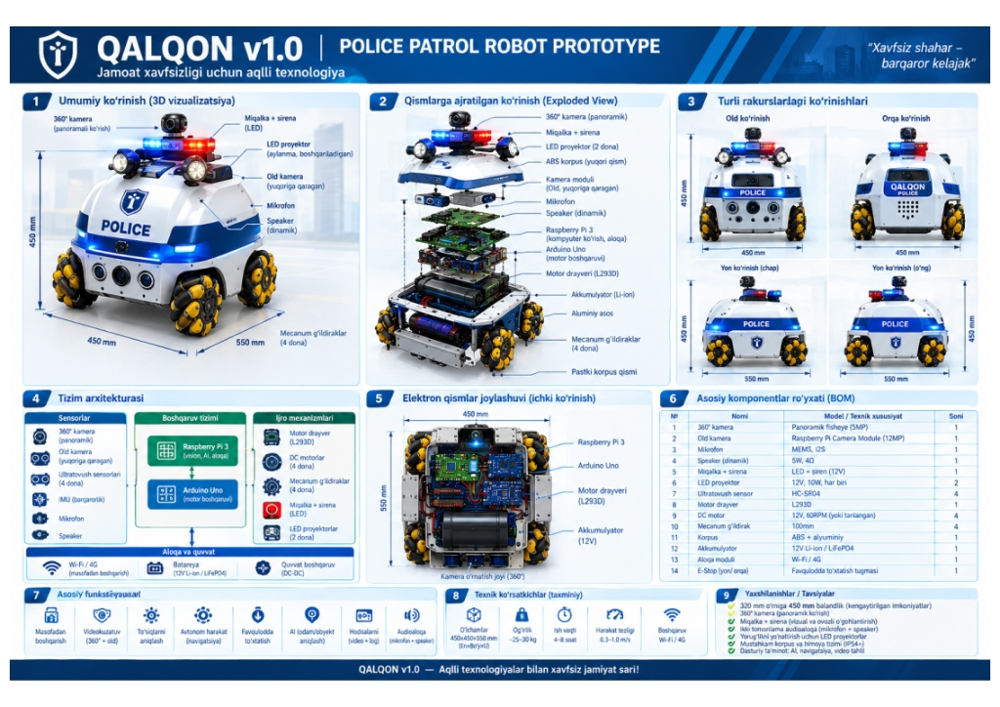
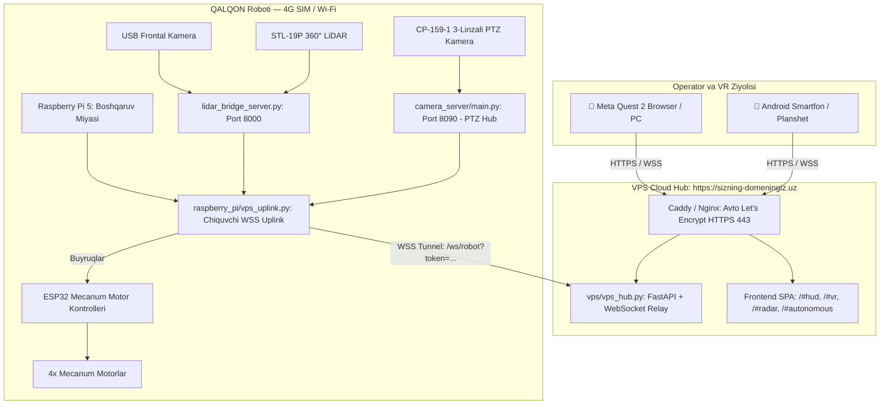

# 🛡️ "QALQON" — IIV Avtonom Patrul va Jamoat Xavfsizligi Roboti



> 📌 **Loyiha maqsadi:** Piyodalar yo‘laklari, istirohat bog‘lari, xiyobonlar va ta’lim maskanlarida jamoat tartibini saqlash, patrullik qilish, sariq taktil yo‘laklar bo‘ylab avtonom harakatlanish, to‘siqlarni chetlab o‘tish hamda **Meta Quest 2 VR** orqali masofadan (4G/5G va Wi-Fi orqali) to‘liq immersiv boshqarish.

---

## 📑 Mundarija

1. [Asosiy Imkoniyatlar](#-asosiy-imkoniyatlar)
2. [Tizim Arxitekturasi](#-tizim-arxitekturasi)
3. [VR Cockpit (Meta Quest 2)](#-vr-cockpit-meta-quest-2)
4. [VPS Cloud Relay & Masofaviy Boshqaruv (4G/5G)](#-vps-cloud-relay--masofaviy-boshqaruv-4g5g)
5. [Tezkor Ishga Tushirish (Quickstart)](#-tezkor-ishga-tushirish-quickstart)
   - [A. VPS Serverni ishga tushirish (Sheriklar uchun)](#a-vps-serverni-ishga-tushirish-sheriklar-uchun)
   - [B. Raspberry Pi 5 ni ulash (Robot ichida)](#b-raspberry-pi-5-ni-ulash-robot-ichida)
   - [C. Meta Quest 2 dan boshqarish](#c-meta-quest-2-dan-boshqarish)
6. [Apparat va Elektronika Komponentlari](#-apparat-va-elektronika-komponentlari)
7. [Veb-Interfeys Marshrutlari](#-veb-interfeys-marshrutlari)
8. [Jamoa Hujjatlari va Qo‘llanmalar](#-jamoa-hujjatlari-va-qollanmalar)

---

## 🌟 Asosiy Imkoniyatlar

- 🥽 **Meta Quest 2 VR Cockpit (WebXR):**
  - WebGL2 asosidagi 112° kavisli IMAX ekran (stereo immersiv rejim).
  - **Oculus Touch** joystiklari orqali real-vaqtda boshqaruv (Mecanum 360° + PTZ kamera Pan/Tilt).
  - Istalgan tarmoqdan (turli Wi-Fi yoki mobil internet orqali) xavfsiz boshqarish.

- 🌐 **VPS Cloud Relay Hub (FastAPI + Caddy SSL):**
  - Yagona maxsus HTTPS domen orqali barcha video (MJPEG), telemetriya va buyruqlarni birlashtiradi.
  - Brauzerlarda **Mixed Content** bloklanishining oldini oladi (faqat 80 va 443 portlar).
  - Robotga oq (statik) IP yoki port yo‘naltirish (port forwarding) talab qilinmaydi.

- 📡 **4G/5G Masofaviy Uplink (Pi 5 -> VPS):**
  - Raspberry Pi 5 chiquvchi `wss://<DOMEN>/ws/robot` orqali VPS ga ulanadi.
  - Video oqimlari (Frontal USB + PTZ 3-linza) tarmoq kengligiga qarab avtomatik optimallashtiriladi.

- 👁️ **Ko‘p Kamerali Tizim:**
  - **Frontal USB Kamera:** Boshqaruv HUD va taktil yo‘lakni kuzatish uchun.
  - **CP-159-1 ONVIF PTZ Kamera:** 3 ta linzali (keng burchakli panorama + harakatlanuvchi PTZ zoom).
  - **Face ID & AI Deteksiya:** Odamlar, yuzlar va to‘siqlarni aniqlash.

- 🛰️ **LiDAR 360° Skanerlash (STL-19P / LD19):**
  - Real vaqtda 10-12 Hz chastotada xaritani skanerlash va to‘siqlarni aniqlash.
  - Taktil yo‘lak va to‘siqlar mavjud bo‘lganda avtonom xavfsizlik to‘xtatish.

- 🏎️ **Mecanum 4WD Shassi va ESP32 Nazorati:**
  - Joyida 360° burilish va yonlama (strafe) harakatlanish imkoniyati.
  - ESP32 orqali MQTT, USB Serial yoki HTTP buyruqlar uzatish.

---

## 🏗️ Tizim Arxitekturasi



---

## 🥽 VR Cockpit (Meta Quest 2)

Meta Quest 2 foydalanuvchilari uchun maxsus WebXR asosida ishlovchi immersiv boshqaruv paneli yaratilgan:

- **Kirish:** Meta Quest Browser da `https://sizning-domeningiz.uz/#vr` manziliga kiriladi.
- **Oculus Touch Kontroller Boshqaruvi:**
  - **Chap Stik (Thumbstick):** 360° Mekanum harakati (oldinga, orqaga, yonlarga siljish va burilish).
  - **O‘ng Stik (Thumbstick):** 3-linzali PTZ kameraning Pan (gorizontal) va Tilt (vertikal) burilishi.
  - **A tugmasi:** Kameralar o‘rtasida almashish (Frontal USB / PTZ 3-linza / Pi Cam).
  - **B tugmasi:** Bosh harakatini (Head-Tracking) PTZ kameraga bog‘lash/uzish.
  - **X tugmasi:** Harakat tezligi rejimini almashtirish (50% / 75% / 100%).
  - **Y tugmasi:** Fara va stroboskop chiroqlarini yoqish/o‘chirish.
  - **Chap Trigger / Grip:** Ovozli signal (Horn / Siren).
  - **O‘ng Trigger / Grip:** Favqulodda to‘xtatish (**E-STOP**).

---

## 🌐 VPS Cloud Relay & Masofaviy Boshqaruv (4G/5G)

Robot ko‘chada mobil internet (4G/5G SIM) orqali ishlaganda unga to‘g‘ridan-to‘g‘ri ulanib bo‘lmaydi (NAT va provayder cheklovlari sababli). Shuning uchun **Chiquvchi WSS Uplink** arxitekturasi joriy etilgan:

1. Robot ichidagi Raspberry Pi 5 VPS dagi xavfsiz manzilga (`wss://<DOMEN>/ws/robot`) o‘zi ulanadi.
2. VPS barcha videolarni, LiDAR skanlarini va sensor ma’lumotlarini qabul qilib, ulangan barcha foydalanuvchilarga (shu jumladan Meta Quest 2 ga) bitta HTTPS domenda tarqatadi.
3. Foydalanuvchilar jo‘natgan barcha joystik va PTZ buyruqlari real vaqtda robotga yetkaziladi.

---

## 🚀 Tezkor Ishga Tushirish (Quickstart)

### A. VPS Serverni ishga tushirish (Sheriklar uchun)

VPS ga kiring va quyidagi buyruqlarni bajaring:

```bash
# 1. Loyihani yuklab olish
git clone https://github.com/Asil2004/My-autnomius-car.git
cd My-autnomius-car/vps

# 2. Sozlamalar faylini tayyorlash
cp .env.example .env
nano .env
# Fayl ichida QALQON_DOMAIN ga o'z domeningizni, QALQON_ROBOT_TOKEN ga maxfiy kalitni yozing!

# 3. Docker orqali ishga tushirish (Caddy avtomatik bepul SSL oladi)
docker compose up -d --build
```

Batafsil ma’lumot uchun: [`vps/README_VPS_DEPLOY.md`](vps/README_VPS_DEPLOY.md)

---

### B. Raspberry Pi 5 ni ulash (Robot ichida)

Raspberry Pi 5 da faqat **1 ta buyruq** beriladi:

```bash
cd ~/My-autnomius-car
git pull origin main

# Avtomatik servis yaratish va ulanish:
sudo bash raspberry_pi/setup_vps_uplink.sh https://sizning-domeningiz.uz SIZNING_MAXFIY_TOKENINGIZ
```

Servis holatini tekshirish:
```bash
sudo systemctl status qalqon-uplink
```

---

### C. Meta Quest 2 dan boshqarish

1. Meta Quest 2 ko‘zoynagini taqing va **Meta Quest Browser** ni oching.
2. Manzil qatoriga yozing:
   ```text
   https://sizning-domeningiz.uz/#vr
   ```
3. Ekranda **"VR KOKPITGA KIRISH (WEBXR)"** tugmasini bosing.
4. Robot frontal yoki PTZ kamerasi ulkan 112° kavisli ekranda namoyon bo‘ladi va Touch pultlari orqali to‘liq boshqarish imkoniyati ochiladi.

---

## 🛠️ Apparat va Elektronika Komponentlari

| Komponent | Model / Turi | Vazifasi | Ulanish Turi |
| :--- | :--- | :--- | :--- |
| **Bosh Boshqaruvchi** | Raspberry Pi 5 (8GB) | Veb-server, video oqim, LiDAR ishlov berish va VPS uplink | USB / Wi-Fi / 4G |
| **Motor Kontrolleri** | ESP32 NodeMCU | 4WD Mecanum motorlarining tezligi va yo‘nalishini boshqarish | USB Serial / MQTT |
| **LiDAR Skaner** | STL-19P / LD19 | 360° xaritani skanerlash va to‘siqlarni aniqlash | USB Serial (`/dev/ttyUSB0`) |
| **Frontal Kamera** | USB HD Veb-Kamera | HUD ekrani va sariq taktil chiziqni aniqlash | USB (`/dev/video0`) |
| **Gumbaz Kamera** | CP-159-1 (3 linzali) | 360° panoramali va optik kattalashtirishli kuzatuv | ONVIF / RTSP / LAN |
| **Shassi va Motorlar** | 4WD Mecanum Platforma | Har qanday yo‘nalishga (strafe) harakatlanish | H-Bridge drayver |
| **Quvvat Manbai** | 12V LiFePO4 / Lipo | Robot motorlari va bort elektronikasini quvvatlash | 5V UBEC konvertor |

---

## 🖥️ Veb-Interfeys Marshrutlari

| Marshrut | Nomi | Vazifasi |
| :--- | :--- | :--- |
| `/#hud` | **Boshqaruv HUD** | Asosiy operator paneli: video oqim, klaviatura/joystik pulti, tezlik, Face ID |
| `/#vr` | **VR Kokpit** | Meta Quest 2 uchun WebXR stereo 112° immersiv boshqaruv |
| `/#radar` | **LiDAR Radar** | 360° LiDAR masofa nurlari va to‘siqlar xaritasi |
| `/#autonomous`| **AI & Taktil Yo‘l** | Ko‘zi ojizlar taktil yo‘lagi (sariq chiziq) bo‘ylab avtonom patrul |
| `/#settings` | **Sozlamalar** | IP kameralar, ESP32 porti, kompas va parametrlar kalibrovkasi |

---

## 📚 Jamoa Hujjatlari va Qo‘llanmalar

- 🌐 [VPS Deploy va Caddy/Nginx Qo‘llanmasi](vps/README_VPS_DEPLOY.md)
- ⚙️ [Mexatronika va Konstruksiya Hisoboti](MEXATRONIKA_HISOBOT_VA_REJA.md)
- 💻 [UI va Frontend Ishlanmalari](UI_uchun_bajarilgan_ishlar.md)
- 🧠 [Raspberry Pi Tizim Integratsiyasi](MIYA_UCHUN_BAJARILGAN_ISHLAR.md)
- 📋 [Jamoa Vazifalari va Rejasi](JAMOA_VAZIFALARI_VA_REJASI.md)

---

© 2026 QALQON IIV Avtonom Patrul Roboti Loyihasi. Barcha huquqlar himoyalangan.
