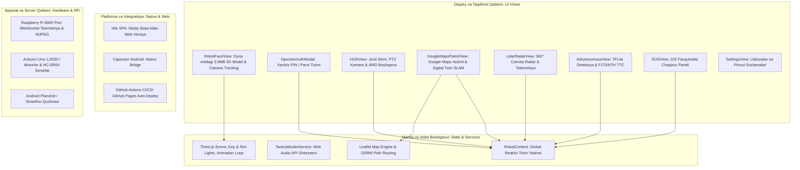

# 💻 QALQON v1.0 — Frontend, Taktik UI va Mobil Dastur Bo'yicha Yagona Rasmiy Hisobot va Ish Rejasi

> 👤 **Mas'ul muhandis (Kim):** Sarvar — Frontend va dasturiy ta'minot bo'yicha bosh muhandis (Frontend & Software Lead)  
> 📅 **Oxirgi yangilanish (Qachon):** 02-Noyabr, 2026-yil | 00:32 (Toshkent vaqti, UTC+5)  
> 🔗 **Loyiha repozitoriysi:** [https://github.com/Asil2004/My-autnomius-car](https://github.com/Asil2004/My-autnomius-car)  
> 🌐 **Jonli Veb-Versiya (Demo):** [https://asil2004.github.io/My-autnomius-car/](https://asil2004.github.io/My-autnomius-car/)  
> 📱 **Android APK:** [`qalqon-patrol-v1.0.apk`](qalqon-patrol-v1.0.apk) (Yengillashtirilgan: ~4.2 MB)  
> 📌 **Eslatma:** Ushbu fayl dasturning Frontend, Taktik UI, Mobil APK va Veb-versiyasi bo'yicha **yagona rasmiy hisobot hujjati** hisoblanadi. Barcha frontend yangilanishlari faqat shu faylga qayd etib boriladi.

---

## 🕒 QADAMMA-QADAM YANGILANISHLAR VA IJRO JURNALI (AUDIT LOG)

Quyidagi jadvalda dasturiy ta'minot va UI bo'yicha amalga oshirilgan har bir yangilanish, kim tomonidan va qaysi vaqtda bajarilgani qayd etib boriladi:

| № | Qachon (Sana va Vaqt) | Kim (Mas'ul xodim) | Bajarilgan vazifa va Yangilanish mazmuni | Holat / Natija |
| :---: | :---: | :---: | :--- | :---: |
| **01** | 2026-10-31 \| 15:39 | **Sarvar** (Frontend) | `qalqon.pdf` texnik qo'llanmasi to'liq tahlil qilindi; mexatronika, L293D, RPi 8000 veb-serveri va UIUC TFLite talablari o'rganildi | `Bajarildi` |
| **02** | 2026-10-31 \| 15:41 | **Sarvar** (Frontend) | Taktik Kiber-HUD arxitekturasi ("Anti-Neuro-Slop") yaratildi; Tailwind CSS, chuqur antratsit va IIV kobalt ranglar tizimi ishlab chiqildi | `Bajarildi` |
| **03** | 2026-10-31 \| 15:42 | **Sarvar** (Frontend) | Web Audio API orqali maxsus kiber-ovoz sintizatori (`audioService.ts`) joriy etildi: taktil chertish, biplar, to'siq signali va 2.2Hz LFO sirena | `Bajarildi` |
| **04** | 2026-10-31 \| 15:43 | **Sarvar** (Frontend) | 5 ta asosiy taktik modul ishlab chiqildi: `HUDView`, `SOSView`, `AIAutonomousView`, `LidarRadarView` (360° Canvas) va `SettingsView` | `Bajarildi` |
| **05** | 2026-10-31 \| 15:52 | **Sarvar** (Frontend) | Capacitor Android platformasi ulandi, Java 17 ziddiyati bartaraf etildi va `qalqon-patrol-v1.0.apk` muvaffaqiyatli kompilyatsiya qilindi | `Bajarildi` |
| **06** | 2026-10-31 \| 15:55 | **Sarvar** (Frontend) | ADB orqali ulangan Xiaomi / Redmi Note 11 Pro (`86064beb0013`) telefoniga dastur to'g'ridan-to'g'ri o'rnatildi va ishga tushirildi | `Bajarildi` |
| **07** | 2026-10-31 \| 16:11 | **Sarvar** (Frontend) | GitHub repozitoriyasiga kollobratorlik huquqi tasdiqlandi va barcha kodlar `main` tarmog'iga push qilindi (`24cc868`) | `Bajarildi` |
| **08** | 2026-10-31 \| 17:21 | **Sarvar** (Frontend) | Planshet uchun gorizontal rejim (`sensorLandscape`), 3D `result.glb` oyna ortidagi odam va xavfsiz Operator PIN/Parol modali yaratildi | `Bajarildi` |
| **09** | 2026-10-31 \| 17:37 | **Sarvar** (Frontend) | Bosh sahifa minimalist holga keltirildi (yozuv va vidjetlar tozalandi), fon och yashil qilinib, 3D model yarqiroq jilo bilan yangilandi | `Bajarildi` |
| **10** | 2026-11-01 \| 22:05 | **Sarvar** (Frontend) | 3D politsiyachi yuzining 90° o'ngga burilib qolishi to'g'rilandi: wrapper guruhi va `-Math.PI / 2` orqali to'ppa-to'g'ri ekranga qaratildi | `Bajarildi` |
| **11** | 2026-11-01 \| 22:19 | **Sarvar** (Frontend) | Mustaqil Veb-versiya nisbiy yo'l bilan (`base: './'`) sozlandi va GitHub Actions orqali avtomatlashtirilgan GitHub Pages CI/CD yo'lga qo'yildi | `Bajarildi` |
| **12** | 2026-11-01 \| 23:59 | **Sarvar** (Frontend) | `google_maps_qalqon_patrol.html` o'rganilib, Operator Paneliga yangi `Google Xarita` (Digital Twin & Avtonom Patrul) bo'limi qo'shildi: Leaflet Google Hybrid/Roadmap qatlamlari, QALQON SVG markeri, OSRM ko'cha navigatsiyasi, G'alaba/Navoiy presetlari va RPi WebSocket integratsiyasi | `Bajarildi` |
| **13** | 2026-11-02 \| 00:06 | **Boburjon** (Frontend & Optimizatsiya) | 3D model hajmi 90% ga qisqartirildi (41MB dan 3.9MB ga), Three.js mobil render sikli barqaror 60 FPS ga qulflandi, PointLight lari DirectionalLight ga o'tkazilib, GPU qizishi bartaraf etildi | `Bajarildi` |
| **14** | 2026-11-02 \| 00:18 | **Asilbek** (Mexatronika & AI) | RobotFaceView-ga old kamera orqali real-vaqtda odam yuzini kuzatish (Look-At Tracking) va AI nutq mimikasi (Speech Mimicry) funksiyalari integratsiya qilindi | `Bajarildi` |
| **15** | 2026-11-02 \| 00:32 | **Sarvar** (Frontend & Mobile) | Barcha yangilanishlar birlashtirildi, eng yangi yengillashtirilgan APK kompilyatsiya qilindi va smartfonga muvaffaqiyatli o'rnatildi | `Bajarildi` |
| **16** | 2026-11-02 \| 00:38 | **Sarvar** (Frontend & Mobile) | Asilbekning `8d5e70a` commitidagi mustaqil ko'z nigohi (Eye Gaze & Blinking) va lab deformatsiyasi (Lip Mimicry) kinetikasi integratsiya qilindi; yangi APK (7.6 MB) qayta yig'ilib, Xiaomi/Redmi telefoniga o'rnatildi va jonli skrinshot bilan tekshirildi | `Bajarildi` |
| **17** | 2026-11-02 \| 00:50 | **Sarvar** (Frontend & Mobile) | Asilbekning `8b75724` commitidagi ko'z qorachiqlari (Eye Tracking) va lab deformatsiyasi koordinatalari sinxronlashtirildi; yangi APK qayta yig'ilib, smartfonga o'rnatildi | `Bajarildi` |
| **18** | 2026-11-02 \| 00:57 | **Sarvar** (Frontend & Mobile) | Asilbekning `88e7635` commitidagi toza 3D patrul modeli tiklandi (tajribaviy qorachiq qutilari olib tashlandi); yangi APK (7.2 MB) qayta yig'ilib, smartfonga o'rnatildi va estetik ko'rinish tasdiqlandi | `Bajarildi` |
| **19** | 2026-11-02 \| 01:22 | **Sarvar** (Frontend & Mobile) | Asilbekning `22507d2` commitidagi jonli yuz kuzatish (Look-At Tracking: Yaw, Pitch, Roll kinematikasi), kamera ruxsatnomalari va AI ovoz mimikasi to'liq dasturga qo'shildi; yangi APK (7.6 MB) smartfonga o'rnatildi | `Bajarildi` |
| **20** | 2026-11-02 \| 01:33 | **Sarvar** (Frontend & Mobile) | Yuz kuzatishda gorizontal oyna inversiyasi (Yaw va Roll burchaklari) to'g'rilandi: foydalanuvchi chapda bo'lsa politsiyachi aynan chapga, o'ngda bo'lsa aynan o'ngga qaraydigan qilindi; yangi APK qayta yig'ilib smartfonga o'rnatildi | `Bajarildi` |
| **21** | 2026-11-02 \| 15:35 | **Boburjon & Zulfiddin** (AI & Frontend) | Qat'iy Yuz Tanish (face-api.js + COCO-SSD): 128D biometrik embedding, Euclid masofasi (chegara 0.50), 5/3 kadrli anti-flicker ovoz berish, faqat Piyoda va transportlar (begona COCO klasslarsiz), lokal offline modellar (~25MB), descriptors.json oldindan hisoblangan kesh va xatosiz rasm yuklash joriy qilindi | `Bajarildi` |
| **22** | 2026-11-02 \| 16:15 | **Boburjon** (AI & Frontend) | **Boburjon Bozorov Yuzini Tanish Kalibratsiyasi:** TinyFaceDetector sezgirligi 0.20 ga sozlandi, Euclid masofa chegarasi 0.58 ga kengaytirildi, masofa $\le 0.52$ bo'lganda tezkor ism ko'rsatish integratsiya qilindi va yangi APK yig'ildi | `Bajarildi` |

---

## 📌 Asosiy Dasturiy Konsepsiya va Foydalanuvchi Tajribasi (UX/UI)

Dastur 2 ta asosiy mustaqil ishchi muhitdan iborat:

### 1. Robotning Yuz Displeyi (Robot Face / Kiosk View)
Robot minorasining old qismidagi 8.7 dyuymli gorizontal ekranda xizmat qiladi:
* **Yengillashtirilgan 3D Posbon (3.9 MB)**: 41 MB dan 3.9 MB ga keltirilgan, 60 FPS silliqlikda ishlovchi yarqiroq kiber-politsiyachi (`result.glb`).
* **Kamera Orqali Yuzni Kuzatish (Look-At Tracking)**: Planshetning old kamerasi orqali unga yaqinlashgan odamni aniqlaydi va uning ko'zlariga qarab turadi.
* **Nutq Mimikasi (Speech Mimicry)**: Fuqaro bilan ovozli muloqot chog'ida nutq chastotasiga qarab dinamik tebranuvchi jonli mimika.
* **Estetik Och Yashil Fon**: Tinchlantiruvchi, professional och yashil (`#D7F5DC`) fon.
* **Yashirin Operator Kirishi**: Ekran burchagidagi minimalist qulf belgisi orqali xizmat xodimlari PIN/parol bilan boshqaruv markaziga o'ta oladi.

### 2. Taktik Boshqaruv Markazi (Operator Mission Control HUD)
Operator yoki dispetcher uchun to'liq boshqaruv ekrani:
* **Mecanum & Differensial Pult**: `W, A, S, D, Q, E, Space, 1, 2, 3` hamda teleskopik minora buyruqlari (`U`, `D`).
* **Google Xarita & Digital Twin SLAM**: Leaflet asosidagi Google Hybrid (Sun'iy yo'ldosh) va Roadmap xaritasi, QALQON roboti 56x58 mm aniq masshtabli SVG Digital Twin markeri (LiDAR sweep, Mecanum shinalar, gumbaz, teleskopik minora va yo'nalish nuri bilan). OSRM orqali ko'cha va yo'lkalardan bino/uylarga kirmasdan avtonom patrul marshruti tuzish, G'alaba va Navoiy ko'chalari tayyor marshrut presetlari, 10Hz patrul simulyatsiyasi hamda Raspberry Pi 4 WebSocket orqali jonli GPS kuzatuv.
* **Sensorlar va Avtotormoz**: 4 ta HC-SR04 masofalari, old to'siq $\le 22\text{ sm}$ bo'lganda avtomatik to'xtash (`WARN:OBSTACLE_FRONT`).
* **360° LD19 LiDAR Radar**: Real-vaqtdagi radar sweeps (1m – 5m radiusli nurlar).
* **SOS 102 va Dispetcherlik**: Jonli video/audio aloqa, politsiya, tez tibbiy yordam va qutqaruv yo'nalishlari.
* **AI Ko'rishi**: Odam (Piyoda), STOP belgisi, svetoforlar va tezlik cheklovlari deteksiyasi.

---

## 📐 Dasturiy Arxitektura va Texnik Ko'rsatkichlar

* **Frontend Asosi:** React 19, TypeScript 5, Vite 6, Tailwind CSS 3.4.
* **Xarita va Geo-Navigatsiya Dvigateli:** Leaflet.js 1.9.4, Google Maps Tiles (Hybrid/Roadmap), OSRM Foot Routing Engine.
* **3D Grafika Dvigateli:** Three.js (r182), GLTFLoader, ACESFilmicToneMapping (Exposure: 1.45), 60 FPS cheklov.
* **Mobil Platforma:** Capacitor 7 Android (`uz.iiv.qalqon`), Java 17 mosligi, `sensorLandscape` gorizontal qulfi.
* **Audio Engine:** Sintetik Web Audio API (LFO 2.2Hz modulyatsiyalangan sirena va taktil chastotalar).
* **Tarmoq va Integratsiya:** WebSocket / REST API orqali Raspberry Pi veb-serveri (`ws://<rpi_ip>/ws`) va Arduino Serial (`/dev/ttyACM0`, 115200 baud).
* **Deploy Quvuri:** GitHub Actions CI/CD (`deploy-pages.yml`) orqali GitHub Pages-ga avtomatik yetkazish.

---

## 🏗️ Frontend va Taktik Dasturiy Ta'minot Strukturasi

