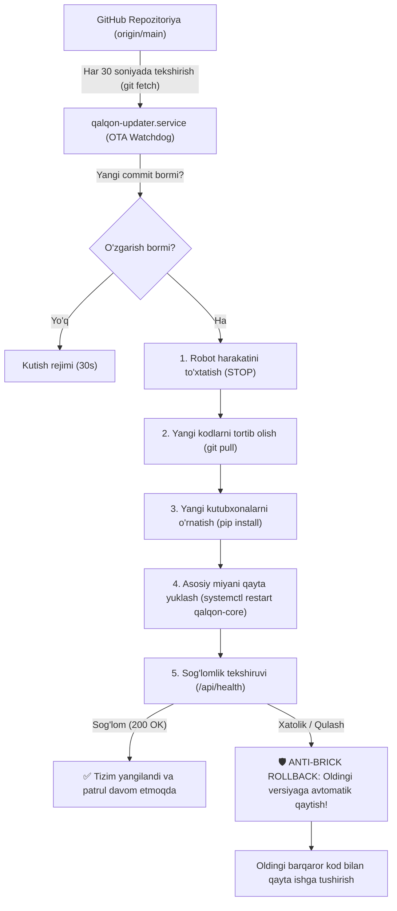

# 🛡️ QALQON v1.0 — Raspberry Pi 4 Avtonom Tizim va OTA (Over-The-Air) Avto-Yangilanish Qo'llanmasi

Ushbu hujjat **«QALQON» avtonom patrul roboti** to'liq yig'ilgandan so'ng, Raspberry Pi 4 kompyuterining **inson aralashuvisiz, butunlay avtonom ishlashi** va GitHub orqali doimiy avtomatik yangilanishi mexanizmini to'liq bayon qiladi.

---

## 1. Tizim Arxitekturasi va Ishlash Prinsipi

Robot ko'chada yoki binoda patrul qilayotganda unga monitor, klaviatura yoki sichqoncha ulab bo'lmaydi. Shu sababli tizim **2 ta mustaqil avtonom xizmat (systemd daemons)** orqali boshqariladi:



---

## 2. Asosiy Komponentlar

| Komponent | Fayl | Vazifasi |
| :--- | :--- | :--- |
| **Asosiy Miya (Core Brain)** | [`qalqon_brain.py`](file:///d:/antigravity/qalqon/raspberry_pi/qalqon_brain.py) | Kamera (AI vision), LiDAR (360° radar), Arduino (4WD motorlar), Web-interfeys va telemetriya serveri. |
| **OTA Avto-Yangilovchi** | [`qalqon_ota_updater.py`](file:///d:/antigravity/qalqon/raspberry_pi/qalqon_ota_updater.py) | GitHub o'zgarishlarini kuzatuvchi, xavfsiz yangilovchi va qayta yuklovchi fon xizmati. |
| **Sog'lomlik tekshiruvi** | `/api/health` | Tizim qayta yuklangandan so'ng uning to'g'ri ishga tushganligini tasdiqlovchi endpoint. |
| **Avtomatik O'rnatuvchi** | [`install_autonomous_services.sh`](file:///d:/antigravity/qalqon/raspberry_pi/install_autonomous_services.sh) | 1 ta buyruq bilan barcha systemd xizmatlari va ruxsatlarni o'rnatuvchi skript. |

---

## 3. Raspberry Pi'ga O'rnatish Tartibi (1 ta Buyruq Bilan)

Raspberry Pi terminalida (SSH yoki to'g'ridan-to'g'ri) repozitoriyaga kiring va o'rnatish skriptini ishga tushiring:

```bash
cd ~/My-autnomius-car/raspberry_pi
sudo bash install_autonomous_services.sh
```

Skript avtomatik ravishda:
1. Tizim papkalari va yo'llarini aniqlaydi.
2. `/var/log/qalqon/` loglar bazasini yaratadi.
3. `/dev/ttyACM*`, `/dev/ttyUSB*` (Arduino) va `/dev/video*` (Kamera) uchun huquqlarni ochadi.
4. `qalqon-core.service` va `qalqon-updater.service` xizmatlarini systemd tizimiga o'rnatadi.
5. `systemctl enable` orqali ularni avtostartga (har safar tok berilganda avtomatik yonadigan qilib) qo'yadi.

---

## 4. Qanday Qilib Avtomatik Yangilanadi?

Siz yoki jamoa a'zolaringiz (Sarvar, Boburjon, Asilbek) o'z kompyuteringizda kodlarni yozib, GitHub repozitoriyasiga push qilasiz:

```bash
git add .
git commit -m "feat(ai): takomillashtirilgan to'siqni aylanib o'tish algoritmi"
git push origin main
```

**Shundan so'ng Raspberry Pi o'zi quyidagilarni bajaradi:**
1. **30 soniya ichida** GitHub'dagi yangi commitni sezadi.
2. Robot xavfsizligi uchun zudlik bilan g'ildiraklarni to'xtatadi (`cmd?c=S`).
3. Yangi kodlarni yuklab oladi (`git pull --ff-only origin main`).
4. Agar yangi Python kutubxonalari qo'shilgan bo'lsa (`requirements.txt`), ularni avtomatik o'rnatadi.
5. Asosiy boshqaruv dasturini yangi kod bilan qayta yuklaydi (`sudo systemctl restart qalqon-core`).
6. `/api/health` orqali 25 soniya davomida tizimni tekshiradi.
7. Hammasi yaxshi bo'lsa, patrul avtomatik davom etadi!

---

## 5. 🛡️ Anti-Brick (Xatolikdan Avtomatik Himoya) Mexanizmi

Agarda yuborilgan yangi kodda:
- Sintaktik xatolik (SyntaxError) bo'lsa,
- Kerakli fayl qolib ketgan bo'lsa,
- Yoki dastur ishga tushmay qulab tushsa (crash):

**Robot ko'chada "g'isht" (ishlamay qolgan metall) bo'lib qolmaydi!**
1. `qalqon_ota_updater.py` sog'lomlik tekshiruvi 25 soniya ichida o'tmaganini aniqlaydi.
2. Zudlik bilan **Avtomatik Rollback (Orqaga Qaytish)** buyrug'ini bajaradi:
   ```bash
   git reset --hard <OLDINGI_BARQAROR_COMMIT>
   ```
3. Oldingi 100% sinovdan o'tgan barqaror kod bilan `qalqon-core` xizmatini qayta yoqadi.
4. Xatolik haqida batafsil ma'lumotni `/var/log/qalqon/ota_updater.log` va `ota_history.json` fayliga yozib qo'yadi.

---

## 6. Foydali Monitoring Buyruqlari

Robot ishini va yangilanishlarni kuzatish uchun buyruqlar:

```bash
# Asosiy robot miyasi holati
sudo systemctl status qalqon-core

# OTA Avto-yangilovchi holati
sudo systemctl status qalqon-updater

# Robotning jonli telemetriya va konsol xabarlari
journalctl -u qalqon-core -f

# OTA yangilanishlar tarixi va hisoboti
tail -f /var/log/qalqon/ota_updater.log
```
