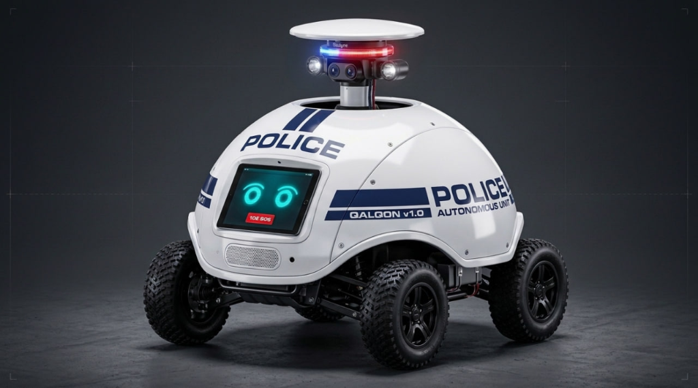
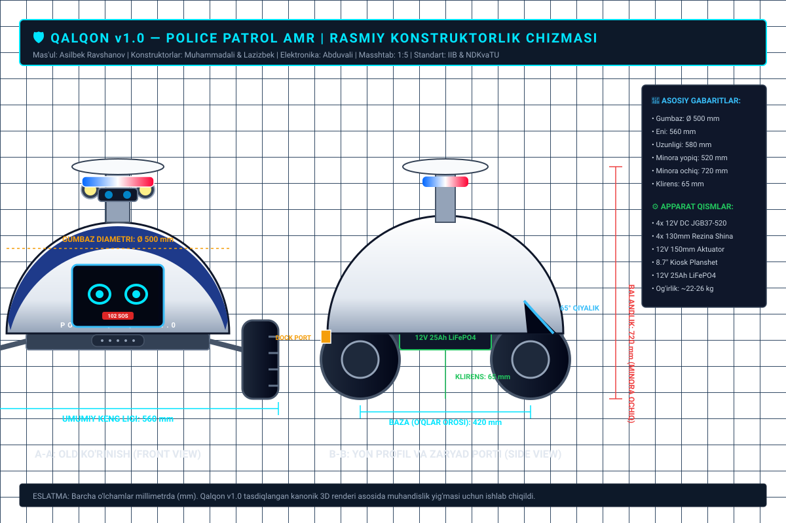

# 📐 «QALQON v1.0» — Rasmiy Konstruktorlik Chizmalari, Gabaritlar va Muhandislik Loyihasi

Ushbu hujjat tasdiqlangan bosh kanonik model asosida **«QALQON v1.0» avtonom patrul roboti**ning to'liq mexanik, konstruksion va elektron komponentlarining o'lchamlari, yig'ish chizmalari hamda mas'ul muhandislar uchun texnik vazifalarni belgilaydi.

---

## 1. 3D Model Umumiy Ko'rinishi va Arxitekturasi

*1-rasm: QALQON v1.0 — Monolit yarim shar gumbaz ($\varnothing 500\text{ mm}$), 4WD oddiy all-terrain shinalar ($\varnothing 130\text{ mm}$), old 8.7" AI planshet ($65^\circ$) va ochilgan teleskopik sensor minorasi.*

---

## 2. Rasmiy Vektorli Gabarit Chizmasi (CAD Blueprint)

*2-rasm: Old ko'rinish (A-A), yon profil va zaryad porti (B-B) hamda asosiy texnik parametrlar.*

---

## 3. Asosiy Geometrik Gabaritlar va Parametrlar

| Ko'rsatkich | O'lcham / Qiymat | Izoh / Standart |
| :--- | :---: | :--- |
| **Gumbaz diametri ($\varnothing$)** | **$500\text{ mm}$** | Monolit yarim shar (ABS / kompozit, 3 mm qalinlik) |
| **Umumiy kenglik (g'ildiraklar bilan)** | **$560\text{ mm}$** | Trotuarlar va tor eshiklardan to'siqsiz o'tish uchun |
| **Umumiy uzunlik** | **$580\text{ mm}$** | Bamperdan orqa zaryadlash portigacha |
| **Balandlik (Minora yopiq / Patrul)** | **$520\text{ mm}$** | Yopiq va aerodinamik himoyalangan holat |
| **Balandlik (Minora ochiq / Faol kuzatuv)** | **$720\text{ mm}$** | Aktuator $+180-200\text{ mm}$ yuqoriga ko'tariladi |
| **Yo'l klirensi (Ground Clearance)** | **$65\text{ mm}$** | Bruschatka, shag'al va kichik bordyurlardan o'tish |
| **G'ildiraklar bazasi (Wheelbase)** | **$420\text{ mm}$** | Old va orqa g'ildiraklar o'qi oralig'i |
| **Shinalar parametri** | **$\varnothing 130\text{ mm} \times 60\text{ mm}$** | Chuqur protektorli all-terrain kauchuk rezina |
| **Umumiy yig'ilgan og'irligi** | **$\approx 24 - 26\text{ kg}$** | Batareya, motorlar, shassi va korpus bilan birga |

---

## 4. Konstruktorlar Uchun Texnik Yechimlar va Takliflar

### 🛠️ A. Muhammadali (@muhammad05092005) — Shassi va Yurish Qismi
1. **Asosiy Asos Plitasi (Chassis Baseplate):**
   * Material: **4 mm D16T duralyuminiy plita** ($450 \times 400\text{ mm}$).
   * Batareya xonasi plitaning qoq o'rtasida va eng pastki qismida joylashadi (og'irlik markazini pastga tushirib, ag'darilish xavfini nolga tenglashtiradi).
2. **Motor Kronshteynlari va Yurish Qismi:**
   * 4 ta 12V DC reduktorli motor (JGB37-520 yoki PG45) 3 mm po'lat L-kronshteynlarga 4 ta M3/M4 bolt bilan mustahkam qotiriladi.
   * G'ildiraklar $12\text{ mm}$ geksagonal guruch adapterlar (hex hubs) orqali motor vallariga ulanadi.
3. **Podveska va Klirens:**
   * Klirens $65\text{ mm}$ qilib belgilandi. Rasmda ko'rsatilganidek mustahkam A-arm yoki to'g'ridan-to'g'ri qattiq L-kronshteynli o'rnatish bo'yicha chizmani tasdiqlash so'raladi.

---

### 🎨 B. Lazizbek / Ali (@ali_ibn_tolib571) — Gumbaz, Planshet Ramkasi va Minora
1. **$\varnothing 500\text{ mm}$ Tashqi Gumbaz:**
   * 3 mm qalinlikdagi oq ABS plastmassadan vakuumda qoliplash yoki 4 ta segmentda 3D printerda chop etilib, kimyoviy biriktiriladi.
   * Yuqori markazda $\varnothing 160\text{ mm}$ doiraviy lyuk teshigi bo'ladi.
   * G'ildiraklar to'siqsiz aylanishi uchun pastki arkalarda $145\text{ mm}$ radiusi bo'yicha qanotlar qirqiladi.
2. **Old 8.7" Planshet Ramkasi ($65^\circ$ Bezel):**
   * Planshet qiyaligi: **$65^\circ$ burchakda** ichkariga joylashtiriladi.
   * Tashqi yuzadan 4 mm polikarbonat (Lexan) himoya oynasi va perimetr bo'ylab silikon suv o'tkazmaydigan qistirma (O-ring) o'rnatiladi.
   * Pastida suv o'tkazmaydigan dinamik panjarasi va mikrofon darchasi ko'zda tutilgan.
3. **Teleskopik Yashirin Minora (Z-Axis Retractable Mast):**
   * 12V mini chiziqli elektr aktuator ($150-180\text{ mm}$ siljish/stroke).
   * 2 dona $\varnothing 8\text{ mm}$ xromlangan yo'naltiruvchi vallar va chiziqli podshipniklar (LM8UU).
   * Minora disk qopqog'i ustida 360° gorizontal LD19 LiDAR, pastrog'ida aylanuvchi politsiya stroboskopi, 2 ta stereo kamera va 2 ta quvvatli LED projektor montaj qilinadi.

---

## 5. Elektron Muhandisi Uchun Texnik Talablar

### ⚡ C. Abduvali (@Abduvali006) — Elektronika, Quvvat va Boshqaruv
1. **Quvvat Ta'minoti (12V LiFePO4):**
   * Batareya: 12V 25Ah LiFePO4 (kamida 6-8 soat uzluksiz patrul).
   * **Avtomatik Zaryadlash Stansiyasi (Docking Station):** Robotning orqa pastki qismida joylashgan 2 ta mis kontaktli plitalar orqali stansiyaga kelib taqalishi bilan avtomatik zaryadlash boshlanadi (BMS kontroller himoyasi bilan).
2. **Quvvat Taqsimlash Platasi (PDB) va DC-DC Konvertorlar:**
   * $12\text{V} \rightarrow 5\text{V } 3\text{A}$ (Raspberry Pi 4 B uchun);
   * $12\text{V} \rightarrow 5\text{V } 3\text{A}$ (Old 8.7" planshetni doimiy zaryadlab turish uchun);
   * $12\text{V} \rightarrow 5\text{V } 2\text{A}$ (Arduino, LiDAR va datchiklar uchun);
   * 12V to'g'ridan-to'g'ri (BTS7960 43A motor drayverlari va aktuator uchun).
3. **Masofadan Boshqaruv va Aloqa Tizimlari:**
   * 4G LTE Wi-Fi router / USB modem (IIV dispetcherlik markazi bilan har qanday nuqtada 100% onlayn aloqa uchun).
   * WebRTC / WebSocket orqali real vaqtli video va telemetriya uzatish.
   * Favqulodda E-Stop apparatli o'chirish tugmasi.
