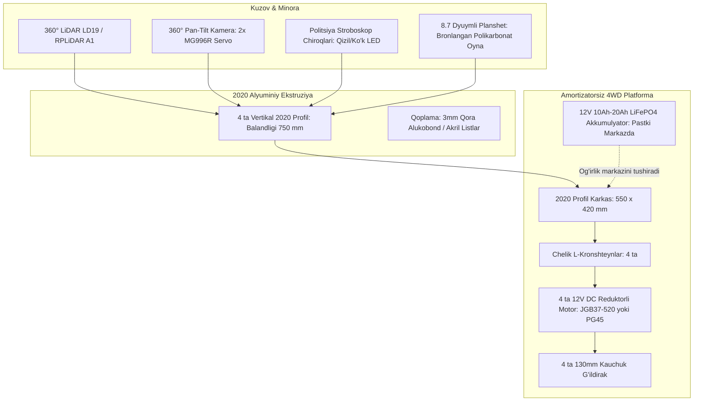

# Talaba Uchun Amortizatorsiz Qo'lda Yig'iladigan IIV Patrul Roboti (DIY Konstruksiya)

Ushbu qo'llanma **Konsept 1 (Stealth Tactical Tower)** dizaynini talaba yoki maktab/universitet laboratoriyasi sharoitida, murakkab avtomobil podveskasi (amortizatorlar) va qimmatbaho CNC frezersiz, oddiy qo'l asboblari bilan 100% amaliy yig'ishga moslashtirilgan variantidir.

---

## 1. Nega Amortizatorsiz (Qattiq Shassi) Talaba Uchun Eng Maqbul Variant?

1. **Konstruktiv soddalik va chidamlilik:**
   * Amortizatorli tizimlar (prujina, richaglar, sharovoy oporalar) piyodalar yo'lagidagi doimiy titrashda buralib ketadi, sozlashni talab qiladi va talaba uchun qo'lda tayyorlash juda murakkab.
   * To'rtburchak **2020 T-Slot alyuminiy profilli** qattiq karkas robotga maksimal mustahkamlik beradi va sinmaydi.
2. **Tabiiy amortizatsiya (Kauchuk shinalar orqali):**
   * Podveska o'rniga **130 mm diametrli havoli (shishiriladigan) yoki yumshoq protektorli rezina shinalar** ishlatiladi.
   * Bu shinalar bruschatka, plitkalar orasidagi yoriqlar va kichik notekisliklarni o'zining elastikligi bilan to'liq yutadi.
3. **Sensorlarning barqarorligi:**
   * Minora baland (1.1 - 1.2 m) bo'lgani sababli, amortizator bo'lsa robot to'xtaganda yoki burilganda tebranib ketadi. Bu holat LiDAR xaritasi va 360° PTZ kamerani chayqatib yuboradi. Qattiq shassida esa minora har doim tik va barqaror turadi.

---

## 2. Asosiy Mexanik Sxema (Mermaid)

---

## 3. O'lchamlar va Geometriya

| Parametr | O'lcham (Talaba loyihasi) | Izoh |
| :--- | :--- | :--- |
| **Umumiy balandligi** | **1150 mm (1.15 m)** | Odam ko'krak balandligida, piyodalar bilan qulay muloqot |
| **Asos (Karkas) o'lchami** | **550 mm (uzunlik) × 420 mm (kenglik)** | Piyodalar yo'lagi va eshiklardan bemalol o'tadi |
| **Klirens (yo'l bilan masofa)** | **45 - 55 mm** | 130mm g'ildirak o'qi markazidan hisoblangan |
| **Og'irligi (umumiy)** | **~12 - 14 kg** | Akkumulyator eng pastki qavatda (robot ag'darilmaydi) |
| **G'ildiraklar bazasi** | **400 mm** | O'qlar orasidagi masofa |
| **G'ildiraklar kengligi** | **440 mm** | Chap va o'ng g'ildirak tashqi chekkalari |

---

## 4. Kerakli Materiallar va Detallar Ro'yxati (BOM)

Barcha detallarni O'zbekistondagi bozorlardan (Malika, Abu Saxiy, O'rikzor) yoki AliExpress / Uumarket / Uzum orqali arzon narxda topish mumkin:

### A. Mexanik qismlar:
1. **2020 V-Slot / T-Slot Alyuminiy Profil:**
   * 550 mm — 2 dona (asos uzunasi)
   * 380 mm — 5 dona (asos ko'ndalangiga va minoraning pastki bog'lamasi)
   * 750 mm — 4 dona (vertikal minora ustunlari)
   * 280 mm — 4 dona (minoraning yuqori tomi va karkasi)
2. **Karkas biriktirgichlari:**
   * 90° burchakli quyma alyuminiy kronshteynlar — 24 dona
   * M5 T-gaykalar (T-nuts) — 60 dona
   * M5 × 8 mm va M5 × 10 mm yarim doira boshli boltlar — 60 dona
3. **G'ildiraklar va Mahkamlash:**
   * 130 mm Robotik rezina g'ildiraklar (olti qirrali 12mm xab bilan) — 4 dona
   * 12 mm Hex motor xabi (val adapteri) — 4 dona
   * JGB37 motorlar uchun qalin chelik L-obrazli kronshteyn — 4 dona

### B. Kuzov Qoplamasi (Korpus):
* **3 mm Alukobond (Alyuminiy kompozit panel):**
  * Qora mat rangli (reklama sexlarida 1 kv.m olib, oddiy lobzik yoki pichoq bilan qirqiladi).
  * Zanglamaydi, yengil, zarbaga chidamli va ichki elektronikani yomg'ir/changdan himoya qiladi.

### C. Elektronika va Boshqaruv:
1. **Drayver va Motorlar:**
   * 4 dona **JGB37-520 12V DC Metal Gear Motor** (100 - 150 RPM, enkoderli)
   * 2 dona **BTS7960 43A Motor Driver** (yoki 1 dona 4 kanalli drayver)
2. **Bosh miya va Sensorlar:**
   * **Raspberry Pi 4 / 5** (yoki Orange Pi 5)
   * **LD19 D300 LiDAR** (yoki RPLiDAR A1M8) — 360° to'siqlarni aniqlash
   * **360° Pan-Tilt Kamera:** 2 ta **MG996R** metall tishli servo motor + USB veb-kamera (Full HD)
   * **3 ta HC-SR04** ultratovush sensori (old va orqa bamperda)
3. **Planshet va Politsiya Chiroqlari:**
   * 8.0 - 8.7 dyuymli arzon Android planshet (Kiosk rejimida)
   * 5V WS2812B RGB adresli LED tasma (yon-atrof stroboskoplari uchun)
   * 1 dona Step-Down DC-DC konverter (12V -> 5V 5A)

---

## 5. Qadamma-Qadam Yig'ish Bosqichlari

### 1-bosqich: Qattiq Shassi Karkasini Yig'ish
1. Ikki dona 550 mm va uch dona 380 mm profildan foydalanib, **"H" yoki "Zina" shaklidagi asosiy ramani** yig'ing.
2. Burchaklarni 90° quyma alyuminiy burchaklar va M5 T-gaykalar bilan qattiq torting.
3. 4 ta motor kronshteynini to'g'ridan-to'g'ri profil pazi (slot) ichiga joylashtiring va boltlar bilan mahkamlang. Amortizator kerak emas — motorlar bevosita karkasga mahkamlanadi!

### 2-bosqich: G'ildiraklar va Og'irlik Markazi
1. G'ildirak xablarini motorning 6 mm D-valiga mahkamlang va 130 mm shinalarni kiygizing.
2. **Eng muhim qoida:** 12V akkumulyatorni eng pastki markaziy profil ustiga rezina tasmalar yoki xomutlar bilan mahkamlang. Og'irlik markazi pastda bo'lsa, baland minora har qanday manyovrda to'ntarilmaydi.

### 3-bosqich: Vertikal Minorani O'rnatish
1. 4 ta 750 mm li profilni shassi markazidan yuqoriga vertikal ravishda tiklang.
2. Old qismiga planshet o'lchamiga mos qilib bitta ko'ndalang profil o'rnating.
3. Planshetni o'rnatish uchun uning ustidan 3-4 mm li shaffof polikarbonat (monolit pleksiglas) oynani M4 boltlar bilan karkasga qisib qo'ying.

### 4-bosqich: 360° Pan-Tilt va LiDAR
1. Minoraning eng yuqori qismiga kichik 150x150 mm metall yoki plastinka plastina o'rnating.
2. Markazga LD19 LiDARni burang.
3. Uning ostiga yoki oldiga 2 ta servo (biri gorizontal 360° aylanish, ikkinchisi vertikal 90° egilish uchun) mexanizmini o'rnatib, USB veb-kamerani joylashtiring.

### 5-bosqich: Alukobond bilan Qoplash (Korpus)
1. Old, orqa va yon devorlar o'lchamlarini oling.
2. Qora Alukobond listlarini lobzik bilan kesib oling.
3. Profil pazlariga M5 T-gaykalar yordamida listlarni tashqi tomondan qotiring. Bu robotga xuddi harbiy zirxlangan mashina ko'rinishini beradi.

---

## 6. Xulosa

Bu konstruksiya:
- **Hech qanday payvandlash (svarka)** talab qilmaydi;
- **Hech qanday maxsus avtomobil podveskasi** talab qilmaydi;
- Oddiy olti qirrali kalit (shestigrannik), otvertka va lobzik bilan yotoqxona yoki laboratoriyada 2-3 kunda to'liq yig'iladi;
- Piyodalar yo'lagida harakatlanish uchun yetarlicha baquvvat va jiddiy IIV patrul uslubiga ega!
